# Valgamaa Äriklubi website: administrator guide

This guide is for the club's website administrators. No technical knowledge is needed: everything is done in the normal WordPress admin, in your web browser.

The admin is set up in **Estonian**. This guide gives the Estonian label first, with the English meaning in brackets, so you can follow it whichever language your admin shows (you can switch your own admin language under Kasutajad → Profiil → "Keel" (Users → Profile → Language)). The screenshots show the Estonian admin.

`<domain>` below means the club website address (for example `ariklubi.ee`).

**Contents**

1. [Logging in and your password](#1-logging-in-and-your-password)
2. [Where things are](#2-where-things-are)
3. [Adding a gallery album](#3-adding-a-gallery-album)
4. [Editing an album: order, removing images, captions](#4-editing-an-album-order-removing-images-captions)
5. [The old album drafts](#5-the-old-album-drafts)
6. [Writing news or an announcement](#6-writing-news-or-an-announcement)
7. [Members](#7-members)
8. [The history table (meetings)](#8-the-history-table-meetings)
9. [Contact details in the footer](#9-contact-details-in-the-footer)
10. [Editing pages](#10-editing-pages)
11. [What NOT to do](#11-what-not-to-do)
12. [If something breaks](#12-if-something-breaks)

---

## 1. Logging in and your password

### Logging in

1. Open **`https://<domain>/wp-admin/`** in your browser.
2. Enter your **username** (or email address) and **password**.
3. Click **"Logi sisse"** (Log In).

   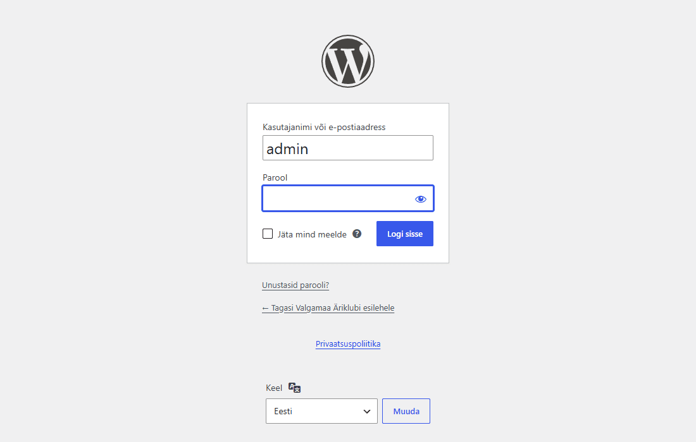

4. The **Töölaud** (Dashboard) opens. The menu on the left leads to everything you need.

   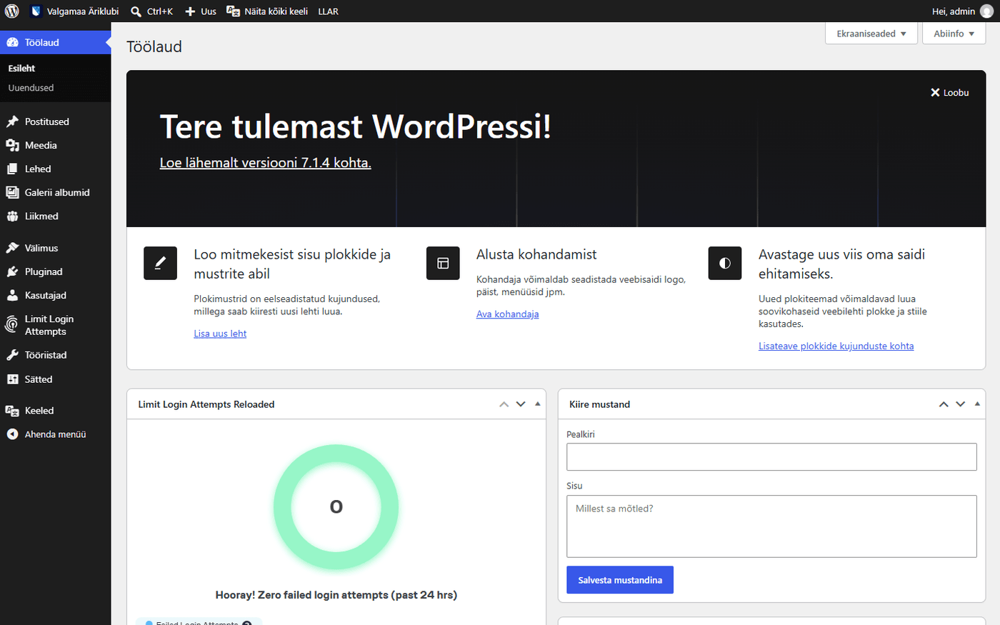

For security, logging in is blocked for a while after several wrong passwords. Wait a little and try again, or reset your password.

### Forgot your password?

1. Click **"Unustasid parooli?"** (Lost your password?) below the login form.
2. Enter your username or email address.
3. You will receive an email with a link to set a new password.

### Changing your password

1. In the left menu choose **Profiil** (Profile) if you have an Editor account, or **Kasutajad → Profiil** (Users → Profile) if you are an Administrator.
2. Scroll down to **"Kontohaldus"** (Account Management).
3. Click **"Sisesta uus parool"** (Set New Password). WordPress suggests a strong password; you can type your own instead.
4. Click **"Uuenda profiili"** (Update Profile) at the bottom.

   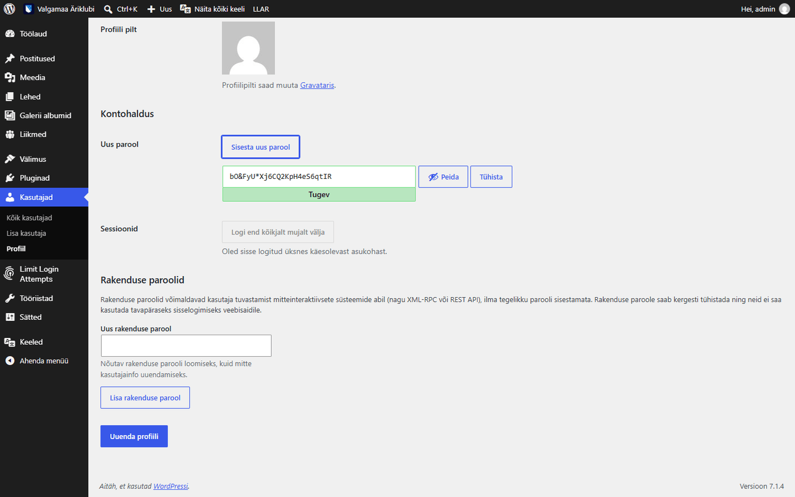

Use a long password (at least 12 characters) that you don't use anywhere else, and keep it in a password manager.

### Logging out

Hover over your name at the top right and choose **"Logi välja"** (Log Out).

---

## 2. Where things are

| On the website | In the admin (left menu) |
|---|---|
| Gallery albums | **Galerii albumid** |
| Member list | **Liikmed** (Members) |
| News and announcements | **Postitused** (Posts) |
| Pages (Home, History, Privacy, …) | **Lehed** (Pages) |
| History meetings table | **Mustrid** (Patterns): not in the menu, open `https://<domain>/wp-admin/edit.php?post_type=wp_block`, see [section 8](#8-the-history-table-meetings) |
| Images and files | **Meedia** (Media) |
| Footer contact details | **Välimus → Moodulid** (Appearance → Widgets), administrators only |
| Main menu | **Välimus → Menüüd** (Appearance → Menus), administrators only |

The website has two languages: **Estonian** (`https://<domain>/`) and **English** (`https://<domain>/en/`).

- **Members, gallery albums and the history table are shared** by both languages. You enter them once and they appear on both the Estonian and the English site.
- **Pages, news, menus and the footer are per language.** The English version is a separate translation (see [section 6](#6-writing-news-or-an-announcement)).

---

## 3. Adding a gallery album

Prepare the photos first:

- **Size:** at most **2560 pixels** on the long edge. WordPress shrinks bigger images itself, but uploading them takes longer.
- **Format:** **JPG**.
- **Amount:** up to about **20 photos per upload**. If you have more, upload them in several batches (into the same album).
- Simple file names help (for example `valga-raekoda-01.jpg`).

### Steps

1. In the left menu hover over **Galerii albumid** (Gallery albums) and choose **Lisa uus album** (Add new album).

   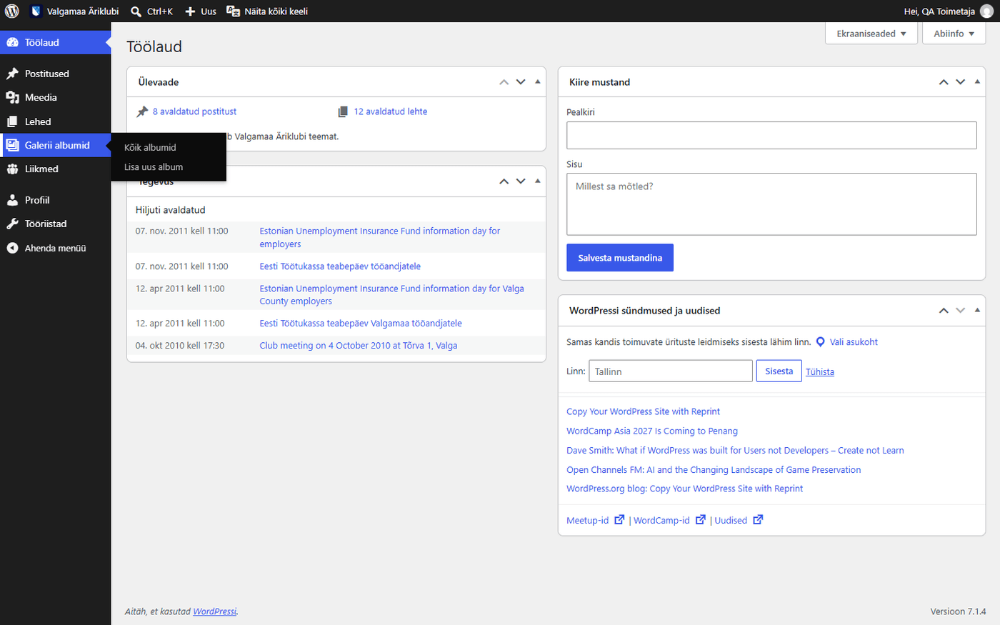

   The first time, a "Tere tulemast redaktorisse" (Welcome to the editor) window opens: close it with the **×** at its top right.

2. **Title:** click **"Lisa pealkiri"** (Add title) and use the form **"DD.MM.YYYY Venue"**, for example `4.11.2024 Valga Raekoda`.
3. **Publish date:** in the right sidebar (tab **"Album"**), on the **"Avalda"** (Publish) row, click **"Otsekohe"** (Immediately). A calendar opens: pick the **event date** (use the arrows to go back a month if needed) and close it with the **×**. This keeps the gallery in the right order (newest first).

   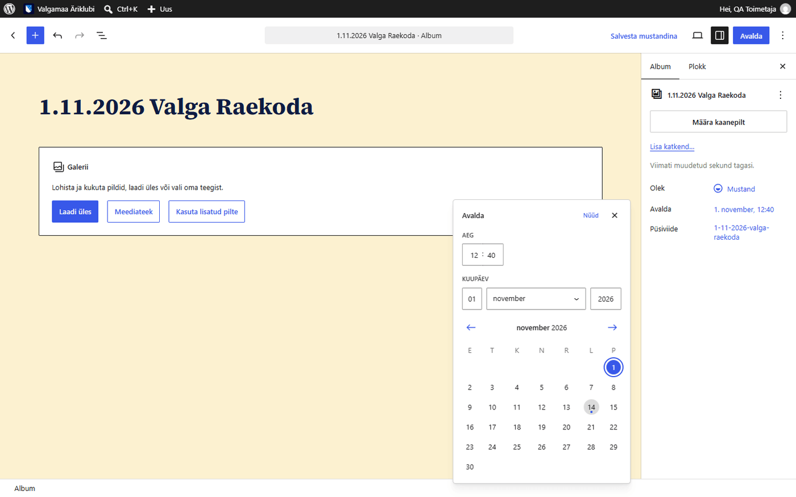

   Always choose today or an earlier date. If you pick a future date, the "Avalda" button turns into **"Järjekord"** (Schedule) and the album only appears on the website on that day.

4. **Gallery block:** a new album already contains a **Galerii** (Gallery) block, with the buttons **"Laadi üles"** (Upload), **"Meediateek"** (Media Library) and **"Kasuta lisatud pilte"** (Use attached images). If you deleted it by accident, click the blue **"+"** at the top left, type **"Galerii"** in the search box and choose the **Galerii** block.

   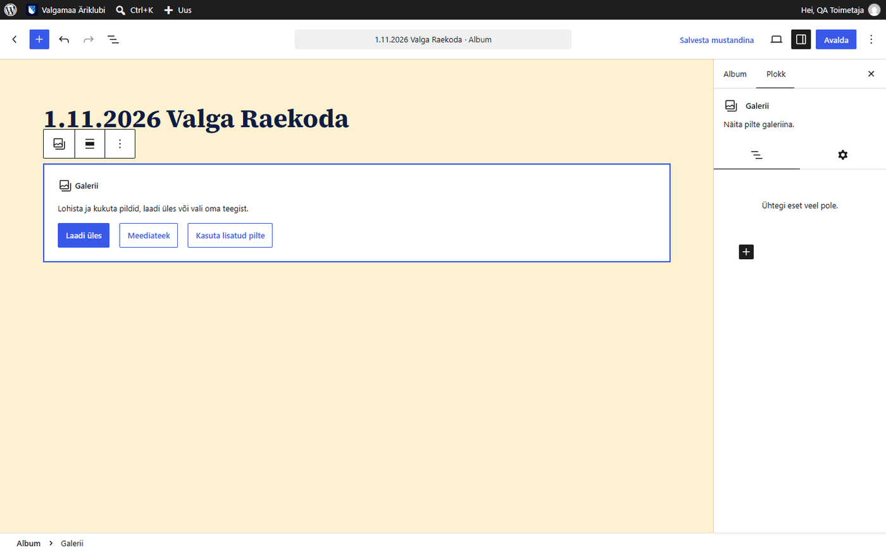

5. **Add the photos:**
   - **"Laadi üles"** (Upload): choose photos from your computer. You can pick many at once: hold **Ctrl** and click the photos, or press **Ctrl + A** to select all photos in the folder. Then click **"Open"** in the file window.
   - You can also simply **drag** the photos from a folder onto the Gallery block.
   - **"Meediateek"** (Media Library): if the photos were uploaded before, select them there, click **"Loo uus galerii"** (Create a new gallery) and then **"Lisa galerii"** (Insert gallery).

   Wait until all photos have finished uploading: no loading indicator on the photos, and the notice **"Üleslaadimine lõpetatud"** (Upload complete) appears at the bottom left.

   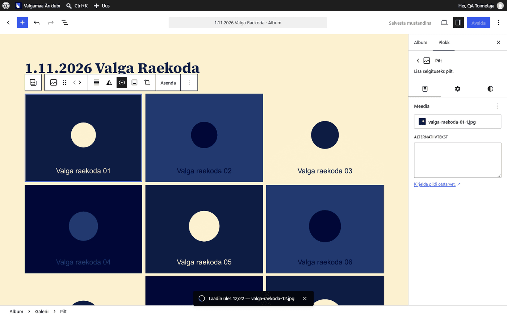

6. **Gallery settings:** select the whole Gallery block (not a single image). The easiest way: click any photo, then click the first toolbar button **"Vali ülemplokk: Galerii"** (Select parent block: Gallery), or click **"Galerii"** in the breadcrumb at the bottom edge. The right sidebar now shows the **"Plokk"** (Block) tab; click the cog icon (**"Sätted"**, Settings) there.
   - **Veerud** (Columns): choose **3** or **4**.

   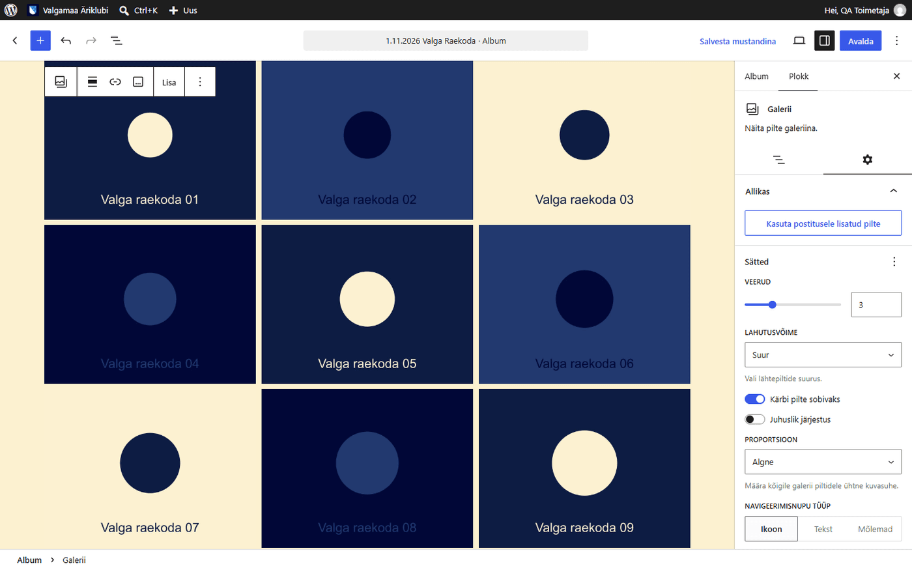

   - **Link:** the gallery toolbar has a link icon (**"Viide"**, Link). By default it is set to **"Puudub"** (None), which is fine: the website still opens a clicked photo large (a "lightbox"). **"Suurenda klikkimisel"** (Expand on click) does the same. **Don't** choose "Lingi pildid manuselehtedega" (Link images to attachment pages) or "Lingi pildid meediafailidega" (Link images to media files): then no lightbox opens.

   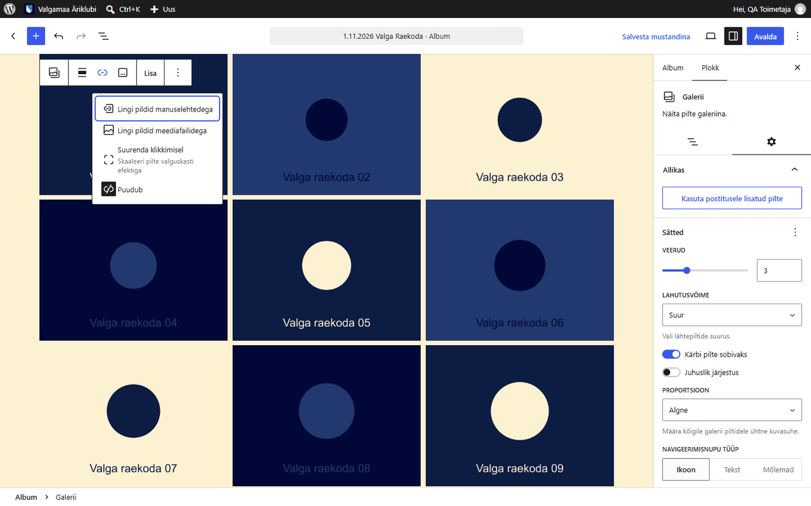

7. **Cover image:** in the right sidebar choose the **"Album"** tab and click **"Määra kaanepilt"** (Set cover image). The "Kaanepilt" (Cover image) window opens: choose the **"Meediateek"** (Media Library) tab, click the photo to show on the album card on the gallery page, and click **"Määra kaanepilt"** at the bottom right. If you don't choose one, the first photo of the gallery is used.

   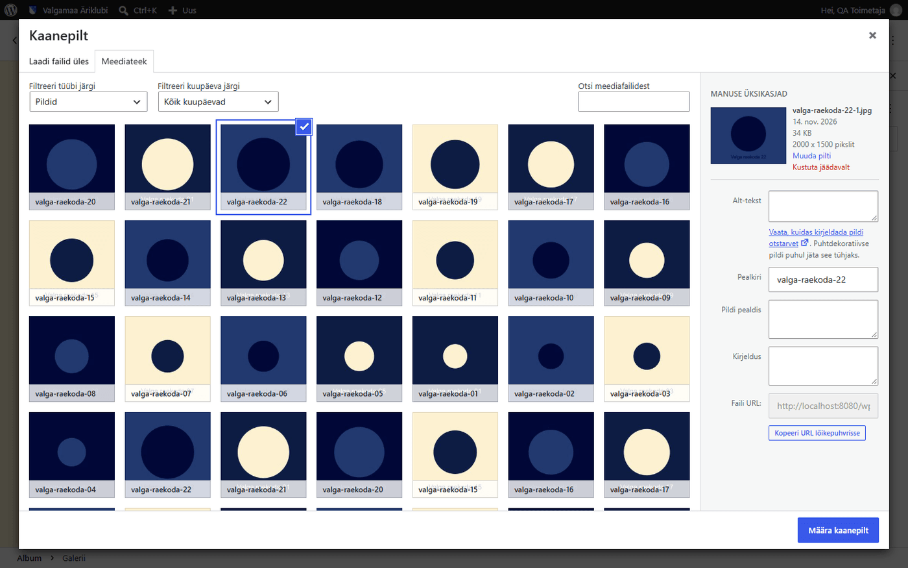

8. Click **"Avalda"** (Publish) at the top right. A summary "Oled valmis avaldama?" (Are you ready to publish?) opens on the right: confirm with **"Avalda"** once more.

   

9. Check the result: open **Galerii** on the website (`https://<domain>/galerii/`). The new album is in the list, and clicking a photo opens it large. In the large view you can move between photos with the arrow keys or the arrow buttons at the screen edges (or by swiping on a phone) and close it with **Esc** or the **×** button at the top right.

   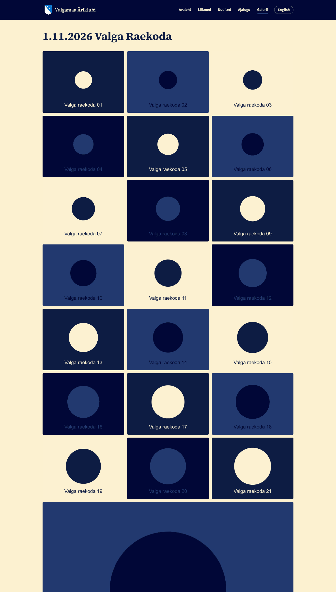

   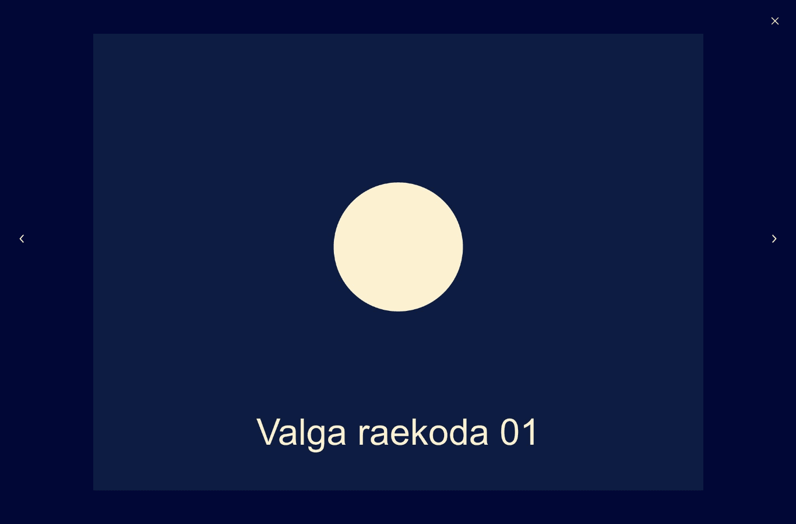

The album also appears automatically on the English gallery page and on the home page ("latest albums"). No translation is needed.

---

## 4. Editing an album: order, removing images, captions

1. Choose **Galerii albumid**, hover over the album name and click **"Muuda"** (Edit).
2. **Changing the order:** click a photo in the gallery. The toolbar above it has arrows (**"Vasakule"** / **"Paremale"**, Move left / Move right). You can also drag the photo to a new position with the dotted toolbar handle (**"Lohista"**, Drag).

   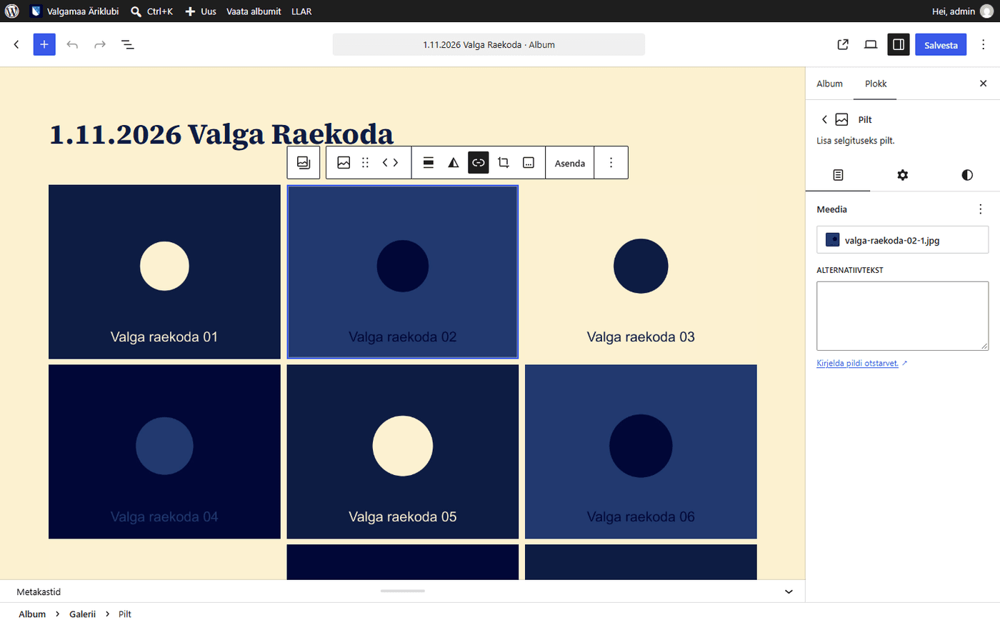

3. **Removing a photo from the album:** click the photo, click the three dots (**⋮**, "Valikud", Options) in the toolbar and choose **"Kustuta"** (Delete) at the bottom. The photo disappears from the album but stays in **Meedia** (Media). To delete it for good, open **Meedia**, select the photo and click **"Kustuta jäädavalt"** (Delete permanently).
4. **Caption:** click the photo, click **"Lisa pealdis"** (Add caption) in the toolbar and type text below it (for example people's names). Captions are optional.
5. **Adding photos to an existing album:** select the Gallery block (see [section 3](#3-adding-a-gallery-album), step 6), click **"Lisa"** (Add) in the toolbar, then **"Laadi üles"** (Upload) or **"Ava meediateek"** (Open Media Library).
6. Click **"Salvesta"** (Save) at the top right to save.

**Deleting an album:** **Galerii albumid** → hover over the album → **"Prügikasti"** (Trash). It can be restored from the trash within 30 days.

---

## 5. The old album drafts

The titles of **76 albums from the old website** have been copied over as **drafts** (without photos). They are not visible on the website until they are published.

1. Choose **Galerii albumid** and click **"Mustandid"** (Drafts) above the list. You will see all the old albums.

   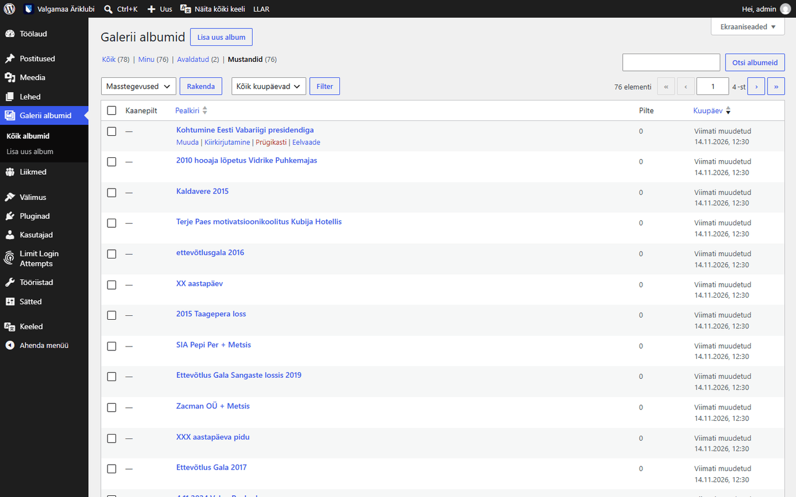

2. Open an album you have photos for (**"Muuda"**, Edit).
3. Check the **title** and the **date** (on the "Avalda" row). The date must be the event date; correct it if needed.
4. Add the photos and the cover as in [section 3](#3-adding-a-gallery-album) (steps 4–7). The old drafts don't contain a Gallery block yet: click the blue **"+"** at the top left, type **"Galerii"** in the search box and choose the **Galerii** block.
5. Click **"Avalda"** (Publish).

If there are no photos for an old album and there won't be, you may delete the draft (**"Prügikasti"**, Trash).

---

## 6. Writing news or an announcement

News items and announcements are **posts**. They appear on the **News** page and on the home page ("latest news").

### Estonian post

1. Choose **Postitused → Lisa postitus** (Posts → Add Post).

   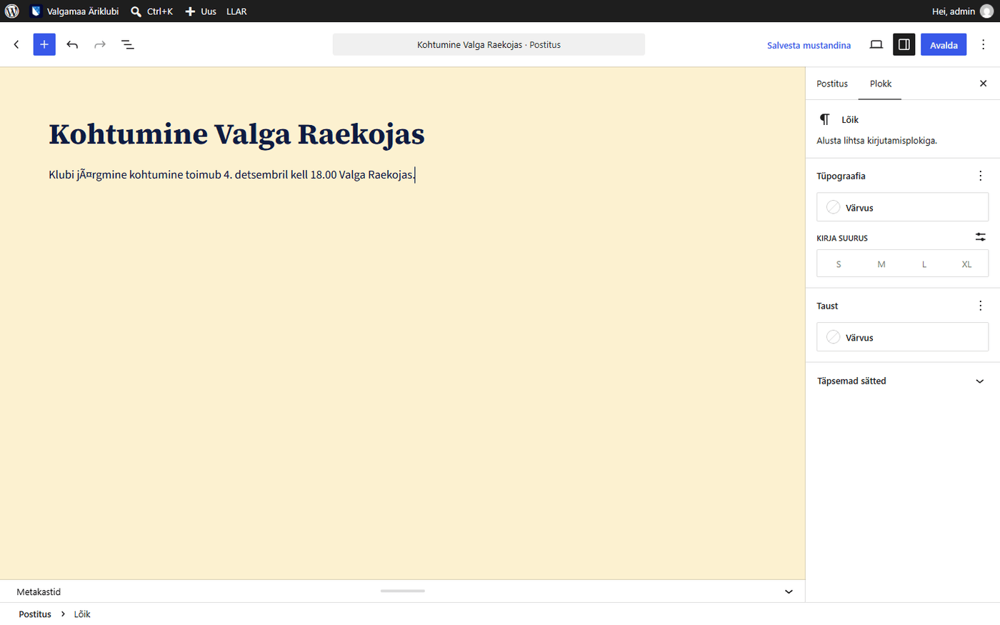

2. Type the **title** and the **text**. Press **Enter** to start a new paragraph. To add an image, click **"+"** and choose the **"Pilt"** (Image) block.
3. In the right sidebar (tab **"Postitus"**, Post):
   - **Rubriigid** (Categories): tick **Uudised** (News) or **Kuulutused** (Announcements), only one. Don't use "Määratlemata" (Uncategorised).
   - **Keeled → Keel** (Languages → Language): check that **Eesti** (Estonian) is selected.
   - **"Lisa katkend…"** (Add an excerpt, optional): 1–2 sentences shown in the news list. If empty, the beginning of the text is used.
   - **"Määra tunnuspilt"** (Set featured image, optional).
   - **Avalda → "Otsekohe"** (Publish → Immediately): for a report about an event you can choose the event date (today or earlier; a future date turns the button into "Järjekord", Schedule).

   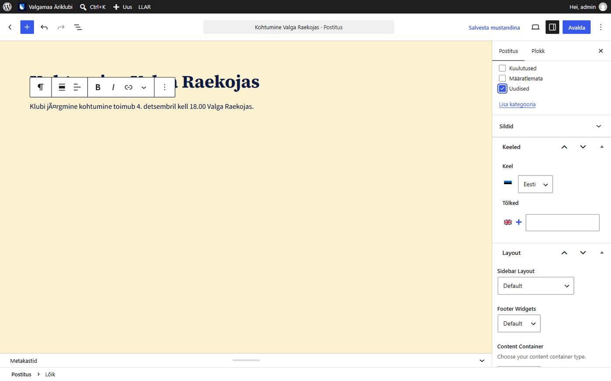

   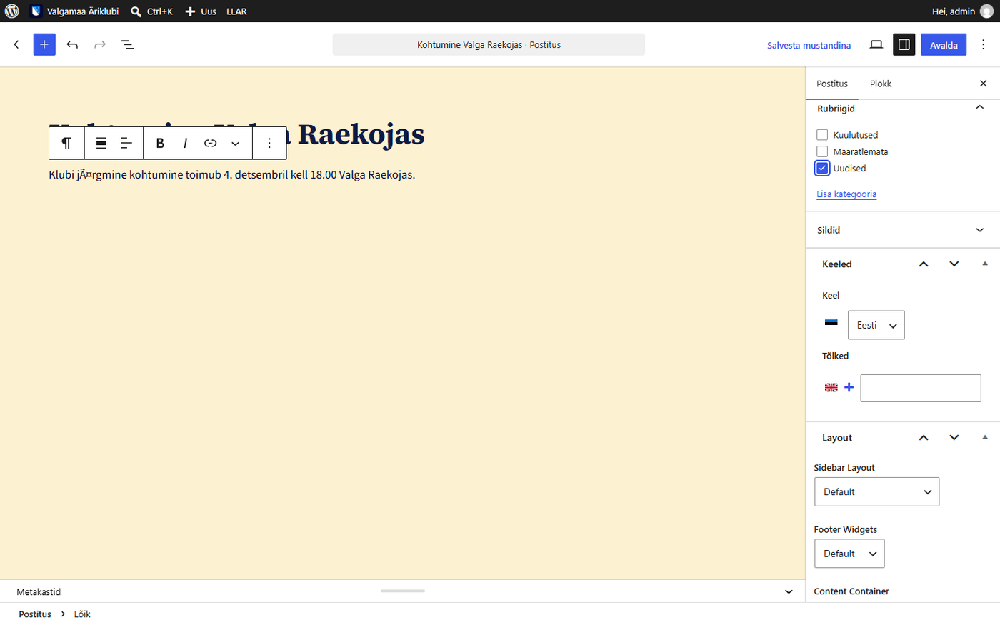

4. Click **"Avalda"** (Publish) and confirm with **"Avalda"** once more.

### English translation (optional)

1. Open the Estonian post (**"Muuda"**, Edit).
2. In the **"Keeled"** (Languages) panel of the right sidebar, look under **"Tõlked"** (Translations). Click the blue **"+"** next to the British flag (English), labelled "Lisa tõlge keeles English" (Add a translation in English). If a translation already exists, a pencil icon ("Muuda tõlget", Edit the translation) is shown instead.

   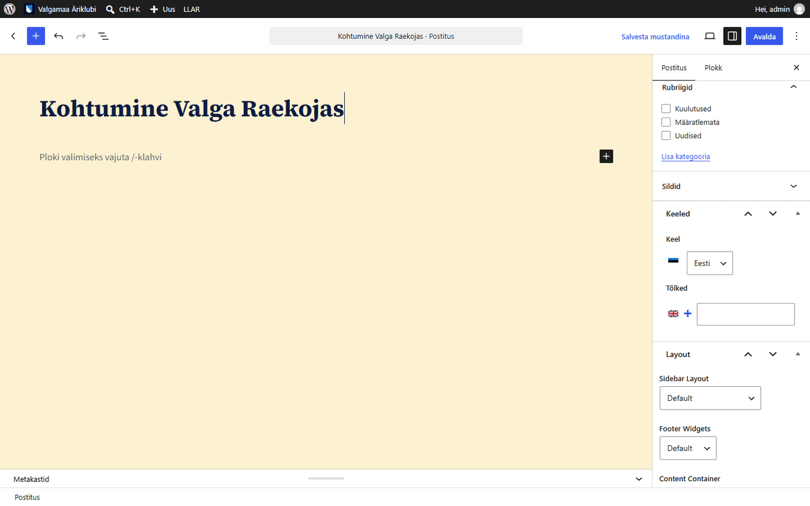

3. A new post opens with the language already set to **English** and linked to the Estonian one. Type the English title and text.
4. Choose the category (**Rubriigid**) **News** or **Announcements** (the English categories).
5. Click **"Avalda"** (Publish) and confirm with **"Avalda"** once more.

If there is no translation, the post simply does not appear on the English site. That is fine.

**Deleting a post:** **Postitused** → hover over the post → **"Prügikasti"** (Trash). Delete the English translation separately if there is one.

---

## 7. Members

The member list is on the **Members** page and is **the same in both languages**. You don't edit the page itself: the list is built automatically.

### Adding a member

1. Choose **Liikmed → Lisa uus liige** (Members → Add new member).
2. **Title:** the member's name as **"Firstname Surname"**, for example `Hans Heinjärv`. The list is sorted automatically by **surname** (the last word of the name).
3. In the **"Ettevõte ja koduleht"** (Company and website) box fill in **Ettevõte** (Company) and **Koduleht** (Website, with `https://`, for example `https://www.pindi.ee`). The website is optional.
4. **Logo or photo** (optional): in the right-hand **"Logo või foto"** (Logo or photo) box click **"Määra logo või foto"** (Set logo or photo).
5. Click **"Avalda"** (Publish) on the right. (The "Postituse atribuudid" and "Lisaväljad" boxes can be left as they are.)

   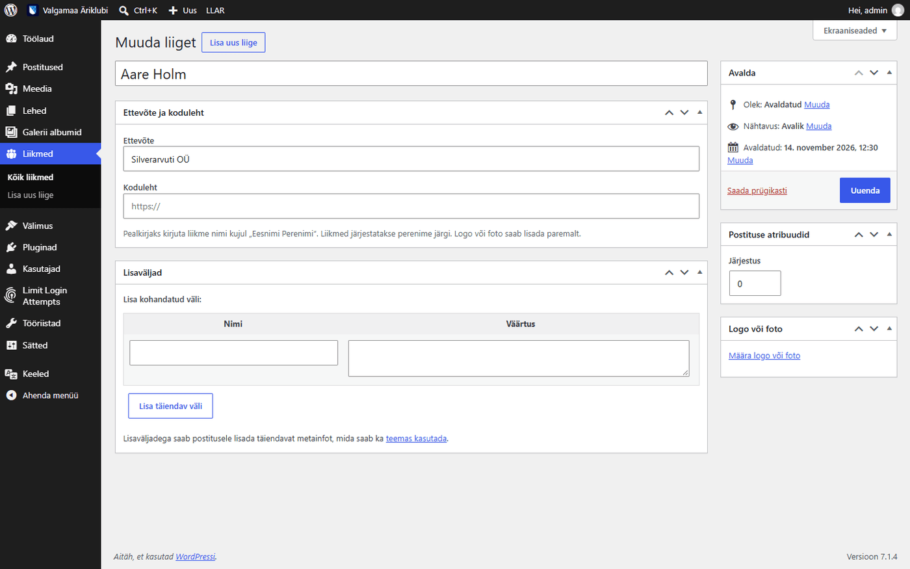

### Editing or removing a member

1. Choose **Liikmed** (Members). The list spans several screens (20 members per screen); use the search box at the top right (**"Otsi liikmeid"**, Search members) to find a member quickly.

   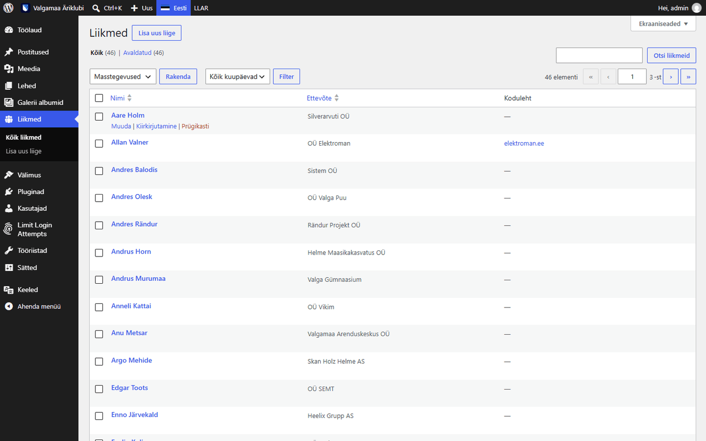

2. Hover over a name:
   - **"Muuda"** (Edit): change the details and click **"Uuenda"** (Update).
   - **"Prügikasti"** (Trash): the member is removed from the website.

If the home page shows a member count (for example "more than 40 business leaders"), it updates automatically where the shortcode `[ak_member_count]` is used.

---

## 8. The history table (meetings)

The meetings table on the **History** page is a **synced pattern** called **"Ajaloo tabel"** (History table). This means it is one and the same table on both the Estonian and the English history page. You edit it in one place and the change appears on both pages.

### Opening the table

1. The pattern list is not in the left menu. Open the address **`https://<domain>/wp-admin/edit.php?post_type=wp_block`** directly in the browser (the page title is **"Mustrid"**, Patterns; worth bookmarking).
2. Hover over **"Ajaloo tabel"** and click **"Muuda"** (Edit).

   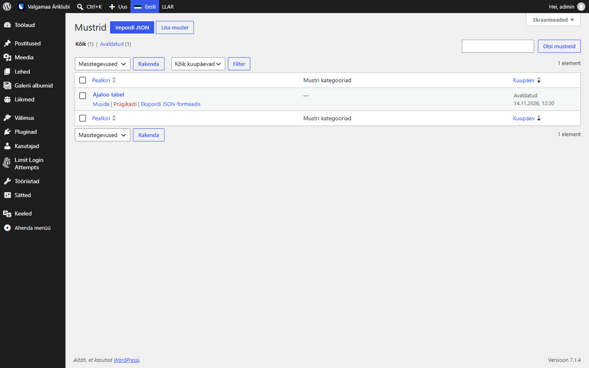

   Alternatively open **Lehed → Ajalugu** (Pages → History), click the table and click **"Muuda originaali"** (Edit original) in the toolbar.

   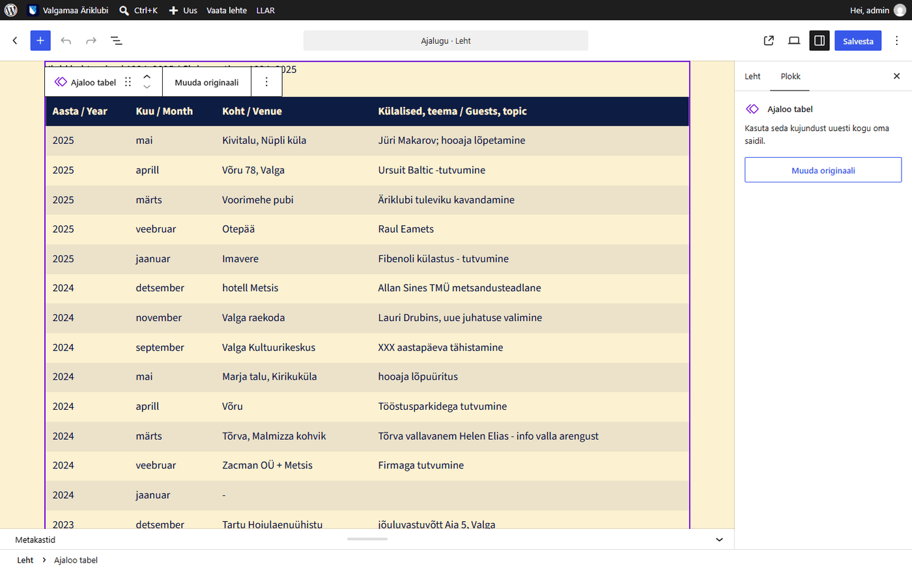

### Adding a new meeting

The newest meetings are at the **top** of the table.

1. Click any cell in the **first data row** (the row just below the header).
2. Click the table icon **"Muuda tabelit"** (Edit table) in the toolbar and choose **"Lisa ette rida"** (Insert row before).

   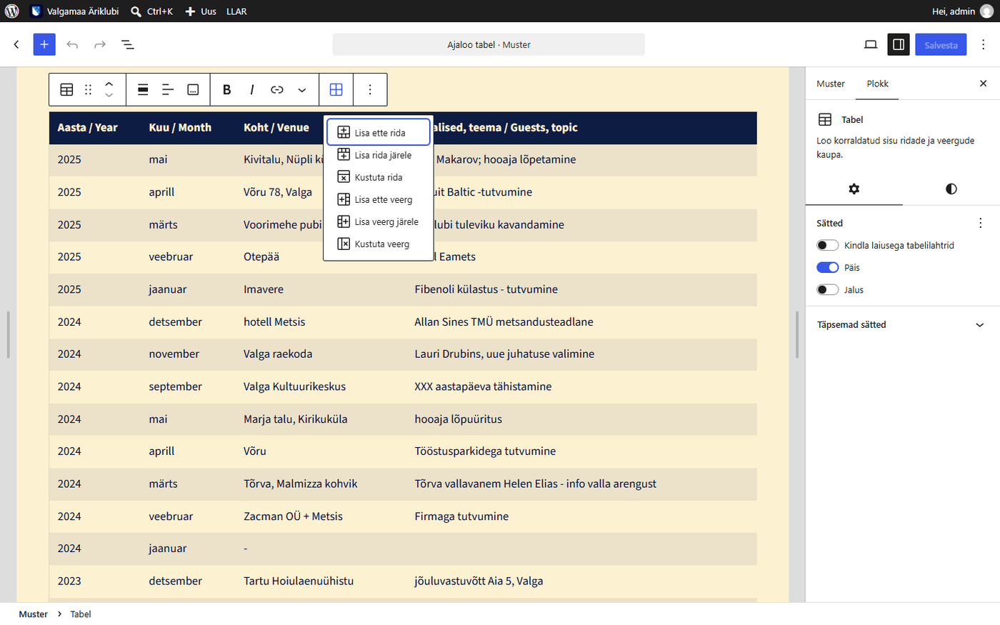

3. Fill in the new row: **Year**, **Month**, **Venue**, **Guests, topic**.
4. Click **"Salvesta"** (Save) at the top right.
5. Check the **Ajalugu** page and the English **History** page on the website: the new row is on both.

**Deleting a row:** click the row → **"Muuda tabelit"** (Edit table) → **"Kustuta rida"** (Delete row).

Don't delete the whole table block or the pattern itself, or the table disappears from both pages.

---

## 9. Contact details in the footer

The bottom of every page (the footer) shows the club's contact details and a short description. These are **widgets** ("moodulid" in the Estonian admin), and **Estonian and English have separate widgets**.

Only an **Administrator** can edit widgets. If you have an Editor account and the contact details change, tell the administrator.

1. Choose **Välimus → Moodulid** (Appearance → Widgets). (If a red notice "Pluginat "generatepress-content-width" ei saa … kuvada" appears at the top, you can close it; it has no effect.)
2. Open the footer area: **"Footer Widget 1"** for the contacts, **"Footer Widget 2"** for the description. Each area has two widgets: the first is **Estonian** (heading "Kontakt" / "Valgamaa Äriklubi"), the second is **English** (heading "Contact" / "Valgamaa Äriklubi" with English text). The widget's language is not shown on this screen; it is stored with the widget and kept when you save.

   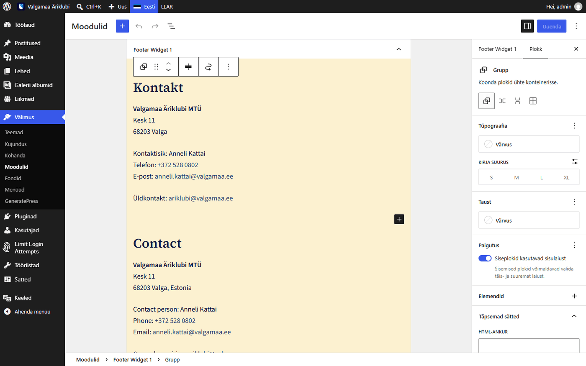

3. Change the text in **both** widgets (Estonian and English) so the details match.
4. Phone and email links: when you change a number or address, also change the link target (`tel:+3725280802`, `mailto:name@valgamaa.ee`). To edit a link, click the linked text and click the link icon in the toolbar.
5. Click **"Uuenda"** (Update) at the top right. The notice "Moodulid salvestatud." (Widgets saved) appears at the bottom.
6. Check both the Estonian and the English website: each footer shows only the contacts in its own language.

**Don't add** new blocks to the footer areas or delete the existing ones: a new block has no language and would appear in both languages at once.

---

## 10. Editing pages

Pages (Home, Members, News, History, Gallery, Privacy) are edited under **Lehed** (Pages). Each page has an Estonian and an English version; update both when you change the content.

1. Choose **Lehed** (Pages), hover over the page and click **"Muuda"** (Edit).
2. Edit the text as in a word processor.
3. Click **"Salvesta"** (Save) at the top right.

### What not to break

Some pages contain **shortcodes**: text in square brackets. They show lists on the website automatically. **Don't delete or change them**:

| Shortcode | What it does |
|---|---|
| `[ak_members]` | Member list (Members page) |
| `[ak_albums count="12" pagination="yes"]` | Album list (Gallery page) |
| `[ak_albums count="3" pagination="no"]` | 3 latest albums (Home) |
| `[ak_latest_news count="3"]` | 3 latest news items (Home) |
| `[ak_member_count]` | Number of members (inside text) |

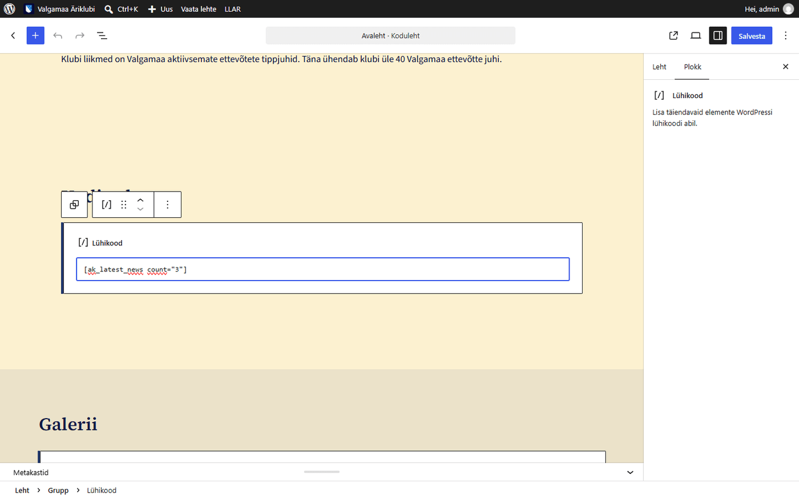

Also don't delete the table block on the **History** page (it is the pattern, see [section 8](#8-the-history-table-meetings)).

Don't change page **addresses** (such as `/liikmed/`) or menu titles without talking to the administrator.

If something goes wrong, you can restore an earlier version of a page: in the right sidebar (tab "Leht", Page) click the **"Versioonid"** (Revisions) row → choose an earlier version → **"Taasta see versioon"** (Restore This Revision). The "Versioonid" row only appears once the page has been changed and saved at least once.

---

## 11. What NOT to do

- **Don't install new plugins.** The website is built so that no extra plugins are needed. Every extra plugin is a security risk and needs maintenance.
- **Don't switch the theme** (Välimus → Teemad, Appearance → Themes) or change theme settings. The design and colours would be lost.
- **Don't change the Polylang settings** (menu **Keeled**, Languages). The languages were set up once, and changing them can break the English site.
- **Don't change** anything under **Sätted** (Settings), especially permalinks and reading settings, unless you are sure.
- **Don't delete** the pages Home, Members, News, History, Gallery, Privacy, or the pattern "Ajaloo tabel".
- **Don't delete** the news categories Uudised/News and Kuulutused/Announcements.
- **Don't share** your user account. A new administrator gets their own account from the site administrator.
- Updates (WordPress, plugins, themes) **happen automatically**. Nothing needs to be updated by hand.

---

## 12. If something breaks

1. **Don't panic.** The website is backed up automatically.
2. If the problem started after your change, try restoring an earlier version of the page (**"Versioonid"**, Revisions, see [section 10](#10-editing-pages)).
3. Write down **what you did**, **when**, and **on which page** the problem is (address, screenshot).
4. Contact the website **administrator**: ______________________ (name, phone, email; filled in at handover).
5. If the website doesn't open at all, or the administrator can't be reached, contact **Zone support** (Zone hosts the website):
   - help desk: through **my.zone.eu**, or email **info@zone.ee**
   - phone: **+372 696 3300**

<!--
Screenshot placeholders used in this guide (docs/img/); shared with ADMIN-GUIDE.et.md (Estonian admin UI):
- img/admin-login.png
- img/admin-dashboard.png
- img/admin-profile-password.png
- img/admin-album-new.png
- img/admin-album-title-date.png
- img/admin-gallery-block-insert.png
- img/admin-gallery-upload.png
- img/admin-gallery-settings-link.png
- img/admin-gallery-link-menu.png
- img/admin-album-featured-image.png
- img/admin-album-publish.png
- img/front-album-desktop-et.png
- img/front-lightbox-desktop-et.png
- img/admin-gallery-reorder.png
- img/admin-album-list-drafts.png
- img/admin-post-new.png
- img/admin-post-category.png
- img/admin-post-language.png
- img/admin-post-add-translation.png
- img/admin-member-edit.png
- img/admin-member-list.png
- img/admin-patterns-list.png
- img/admin-history-synced-block.png
- img/admin-history-table-add-row.png
- img/admin-widgets-footer.png
- img/admin-page-shortcodes.png
QA (WS-G, 2026-11-14): screenshots and Estonian labels checked against the local Estonian WordPress 7.1.4
admin. Still to verify by the owner: Zone support phone/email.
-->
