# Valgamaa Äriklubi kodulehe haldamise juhend

See juhend on mõeldud klubi kodulehe haldajatele. Tehnilisi teadmisi pole vaja: kõik toimub tavalises WordPressi halduskeskkonnas, veebilehitseja kaudu.

`<domeen>` tähendab allpool klubi kodulehe aadressi (näiteks `ariklubi.ee`).

**Sisukord**

1. [Sisselogimine ja parool](#1-sisselogimine-ja-parool)
2. [Mis kus asub](#2-mis-kus-asub)
3. [Uue galerii albumi lisamine](#3-uue-galerii-albumi-lisamine)
4. [Albumi muutmine: piltide järjekord, kustutamine, allkirjad](#4-albumi-muutmine-piltide-järjekord-kustutamine-allkirjad)
5. [Vanade albumite mustandid](#5-vanade-albumite-mustandid)
6. [Uudise või kuulutuse kirjutamine](#6-uudise-või-kuulutuse-kirjutamine)
7. [Liikmed](#7-liikmed)
8. [Ajaloo tabel (kohtumised)](#8-ajaloo-tabel-kohtumised)
9. [Kontaktandmed jaluses](#9-kontaktandmed-jaluses)
10. [Lehtede muutmine](#10-lehtede-muutmine)
11. [Mida MITTE teha](#11-mida-mitte-teha)
12. [Kui midagi läheb katki](#12-kui-midagi-läheb-katki)

---

## 1. Sisselogimine ja parool

### Sisselogimine

1. Ava veebilehitsejas aadress **`https://<domeen>/wp-admin/`**.
2. Sisesta oma **kasutajanimi** (või e-posti aadress) ja **parool**.
3. Vajuta **"Logi sisse"**.

   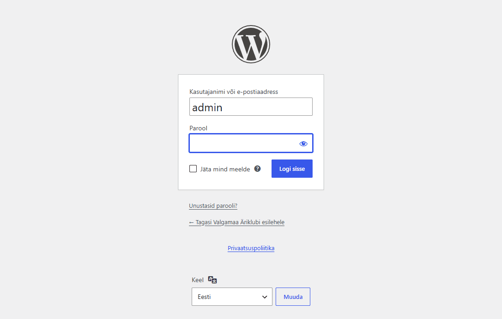

4. Avaneb **Töölaud** (avaleht halduskeskkonnas). Vasakul on menüü, mille kaudu jõuad kõigi tegevusteni.

   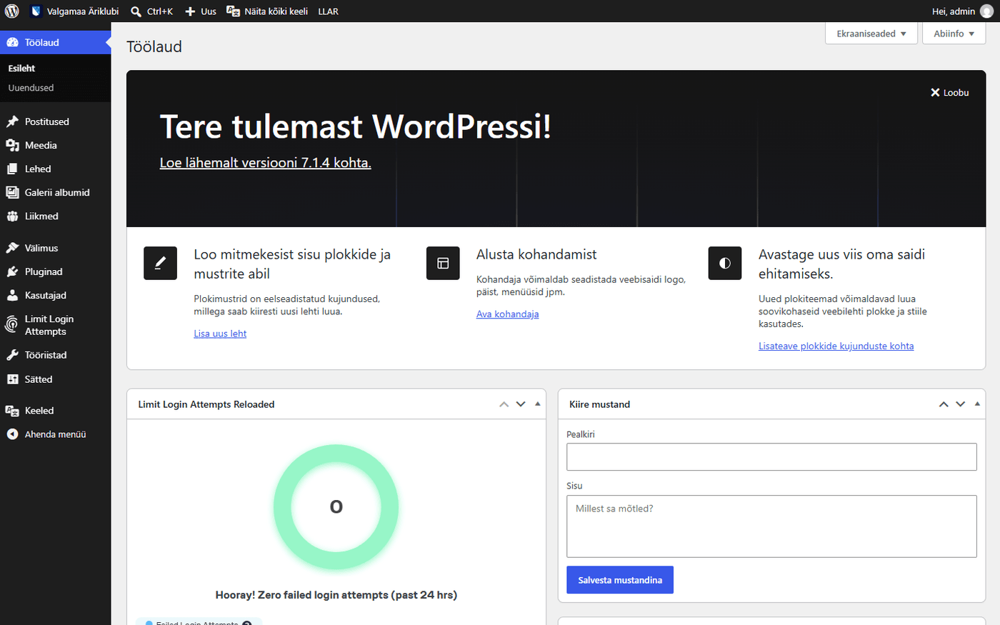

Turvalisuse pärast lukustab koduleht sisselogimise mõneks ajaks, kui parool on mitu korda valesti sisestatud. Oota natuke ja proovi uuesti või taasta parool.

### Unustasid parooli?

1. Vajuta sisselogimise vormi all lingile **"Unustasid parooli?"**.
2. Sisesta oma kasutajanimi või e-posti aadress.
3. Sulle saadetakse e-kiri lingiga, mille kaudu saad määrata uue parooli.

### Parooli muutmine

1. Vasakul menüüs vali **Profiil** (toimetaja konto) või **Kasutajad → Profiil** (administraatori konto).
2. Keri lehe alaossa jaotiseni **"Kontohaldus"**.
3. Vajuta **"Sisesta uus parool"**. WordPress pakub tugeva parooli; võid selle asemel kirjutada oma parooli.
4. Vajuta lehe lõpus **"Uuenda profiili"**.

   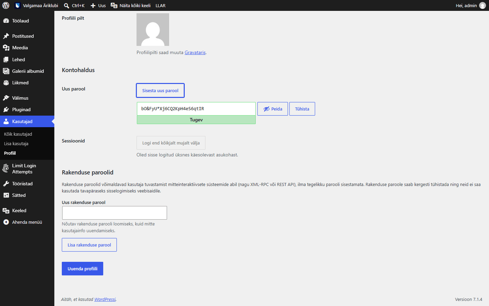

Kasuta pikka parooli (vähemalt 12 märki) ja ära kasuta sama parooli teistes kohtades. Hoia parooli paroolihalduris.

### Väljalogimine

Vii hiir paremal üleval oma nime peale ja vali **"Logi välja"**.

---

## 2. Mis kus asub

| Kodulehel | Halduskeskkonnas (vasak menüü) |
|---|---|
| Galerii albumid | **Galerii albumid** |
| Liikmete nimekiri | **Liikmed** |
| Uudised ja kuulutused | **Postitused** |
| Lehed (Avaleht, Ajalugu, Privaatsus jne) | **Lehed** |
| Ajaloo kohtumiste tabel | **Mustrid** – menüüs seda ei ole, ava aadress `https://<domeen>/wp-admin/edit.php?post_type=wp_block` (vt [peatükk 8](#8-ajaloo-tabel-kohtumised)) |
| Pildid ja failid | **Meedia** |
| Jaluse kontaktandmed | **Välimus → Moodulid** (ainult administraator) |
| Peamenüü | **Välimus → Menüüd** (ainult administraator) |

Koduleht on kahes keeles: **eesti** (aadress `https://<domeen>/`) ja **inglise** (`https://<domeen>/en/`).

- **Liikmed, galerii albumid ja ajaloo tabel on ühised** mõlemale keelele. Neid sisestad ainult üks kord ja need ilmuvad nii eesti- kui ka ingliskeelsele lehele.
- **Lehed, uudised, menüüd ja jalus on keelepõhised.** Ingliskeelne versioon on eraldi tõlge (vt [peatükk 6](#6-uudise-või-kuulutuse-kirjutamine)).

---

## 3. Uue galerii albumi lisamine

Enne alustamist valmista pildid ette:

- **Suurus:** pikem külg kuni **2560 pikslit**. Suuremad pildid vähendab WordPress ise, aga üleslaadimine on siis aeglasem.
- **Vorming:** **JPG**.
- **Kogus:** korraga kuni umbes **20 pilti**. Kui pilte on rohkem, lae need üles mitmes osas (samasse albumisse).
- Failinimed võiks olla lihtsad (näiteks `valga-raekoda-01.jpg`).

### Sammud

1. Vasakul menüüs too hiir **Galerii albumid** peale ja vali **Lisa uus album**.

   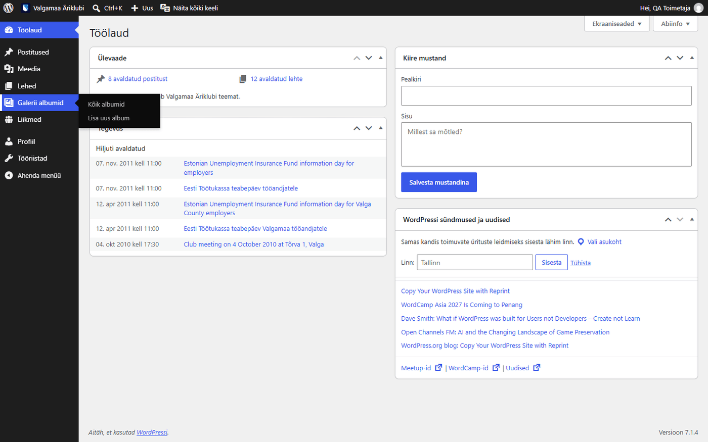

   Esimesel korral avaneb tervitusaken "Tere tulemast redaktorisse" – sulge see paremal üleval **×** märgiga.

2. **Pealkiri:** klõpsa kirjale **"Lisa pealkiri"** ja kirjuta kujul **"PP.KK.AAAA Koht"**, näiteks `4.11.2024 Valga Raekoda`.
3. **Avaldamise kuupäev:** paremal külgribal (vahekaart **"Album"**) vajuta real **"Avalda"** sõnale **"Otsekohe"**. Avaneb kalender: vali **ürituse kuupäev** (vajadusel liigu nooltega eelmisesse kuusse) ja sulge aken **×** märgiga. Nii on albumid galeriis õiges järjekorras (uuemad eespool).

   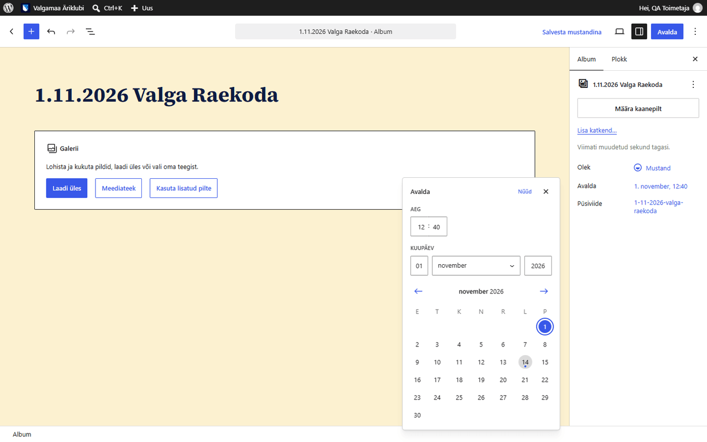

   Vali alati tänane või varasem kuupäev. Kui valid tulevikus oleva kuupäeva, muutub nupp "Avalda" nupuks **"Järjekord"** ja album ilmub kodulehele alles sel päeval.

4. **Galerii plokk:** uues albumis on sisualal **Galerii** plokk juba olemas (nupud **"Laadi üles"**, **"Meediateek"**, **"Kasuta lisatud pilte"**). Kui oled selle kogemata kustutanud, vajuta üleval vasakul sinist **"+"** nuppu, kirjuta otsingusse **"Galerii"** ja vali plokk **Galerii**.

   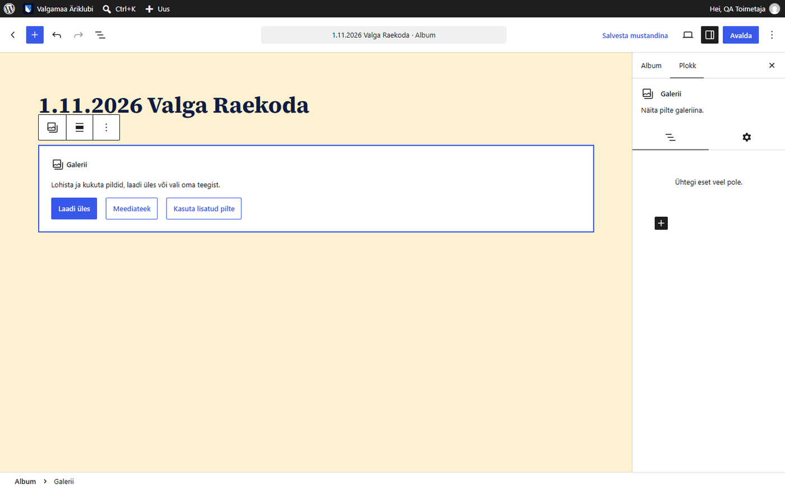

5. **Lisa pildid:**
   - **"Laadi üles"** – vali pildid oma arvutist. Mitu pilti saad valida korraga: hoia all **Ctrl**-klahvi ja klõpsa piltidel, või vajuta **Ctrl + A**, et valida kõik kaustas olevad pildid. Seejärel vajuta **"Ava"**.
   - Võid pildid ka lihtsalt **lohistada** arvuti kaustast galerii ploki peale.
   - **"Meediateek"** – kui pildid on juba varem üles laaditud, vali need sealt ja vajuta **"Loo uus galerii"** ning siis **"Lisa galerii"**.

   Oota, kuni kõik pildid on üles laaditud: piltide peal ei ole enam laadimise märki ja all vasakul ilmub teade **"Üleslaadimine lõpetatud"**.

   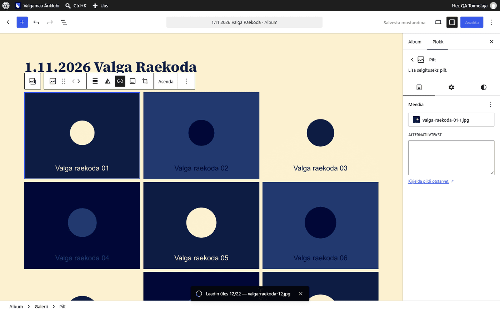

6. **Galerii seaded:** vali kogu galerii plokk (mitte üksik pilt). Kõige lihtsam: klõpsa ükskõik millisel pildil ja vajuta siis tööriistariba esimesele nupule **"Vali ülemplokk: Galerii"** (või klõpsa lehe all servas teekonnal sõnale **"Galerii"**). Paremal külgribal on nüüd avatud vahekaart **"Plokk"**; vajuta seal hammasratta ikoonile (**"Sätted"**).
   - **Veerud:** vali **3** või **4**.

   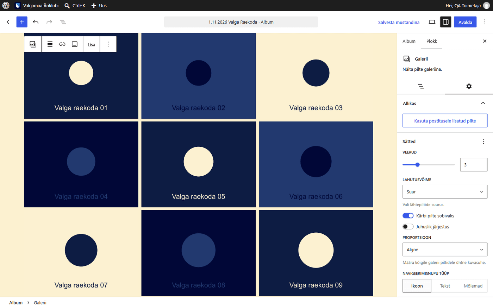

   - **Link:** galerii tööriistaribal on lingi ikoon (**"Viide"**). Vaikimisi on seal valitud **"Puudub"** – see sobib: koduleht avab pildi klõpsates ikkagi suurelt (nn valguskast). Sama teeb ka valik **"Suurenda klikkimisel"**. **Ära vali** "Lingi pildid manuselehtedega" ega "Lingi pildid meediafailidega", siis valguskasti ei avane.

   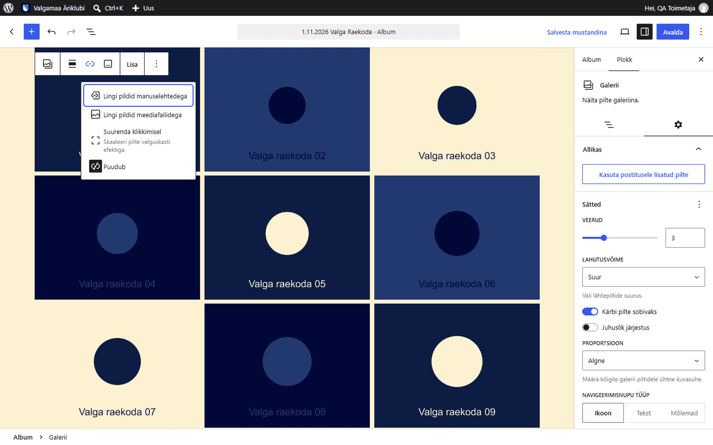

7. **Kaanepilt:** paremal külgribal vali vahekaart **"Album"** ja vajuta **"Määra kaanepilt"**. Avaneb aken "Kaanepilt": vali vahekaart **"Meediateek"**, klõpsa pildil, mis näidatakse galerii lehel albumi kaardil, ja vajuta all paremal **"Määra kaanepilt"**. Kui kaanepilti ei vali, kasutatakse galerii esimest pilti.

   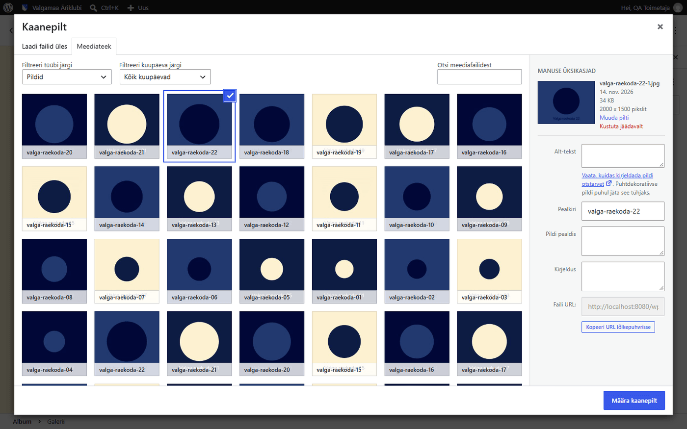

8. Vajuta paremal üleval **"Avalda"**. Paremale avaneb kokkuvõte "Oled valmis avaldama?" – kinnita veel kord **"Avalda"**.

   

9. Kontrolli tulemust: ava kodulehel **Galerii** (`https://<domeen>/galerii/`). Uus album on nimekirjas ning pildile klõpsates avaneb see suurelt. Suures vaates saab pilte vahetada nooleklahvidega või ekraani servas olevate noolenuppudega (telefonis ka sõrmega libistades) ja sulgeda klahviga **Esc** või paremal üleval **×** nupuga.

   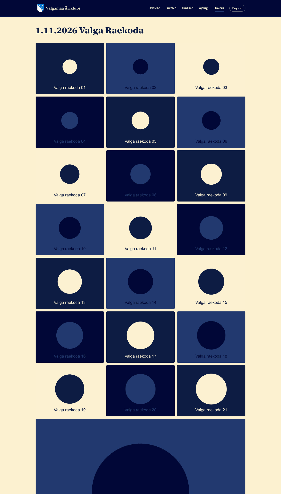

   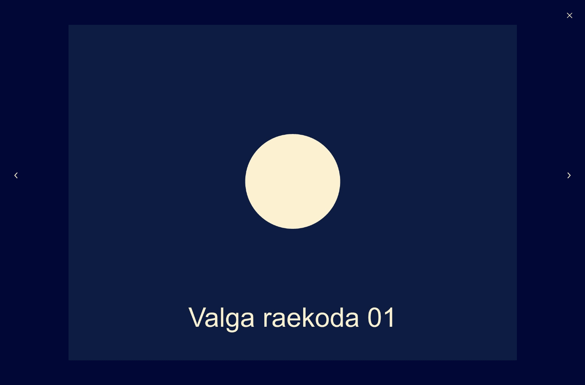

Album ilmub automaatselt ka ingliskeelsele galeriilehele ja avalehele ("viimased albumid"). Eraldi tõlget pole vaja.

---

## 4. Albumi muutmine: piltide järjekord, kustutamine, allkirjad

1. Vali **Galerii albumid**, too hiir albumi nime peale ja vajuta **"Muuda"**.
2. **Piltide järjekorra muutmine:** klõpsa pildil galeriis. Pildi kohal olevas tööriistaribal on nooled (**"Vasakule"** / **"Paremale"**). Pilti saab ka tööriistariba punktidega ikoonist (**"Lohista"**) hiirega uude kohta lohistada.

   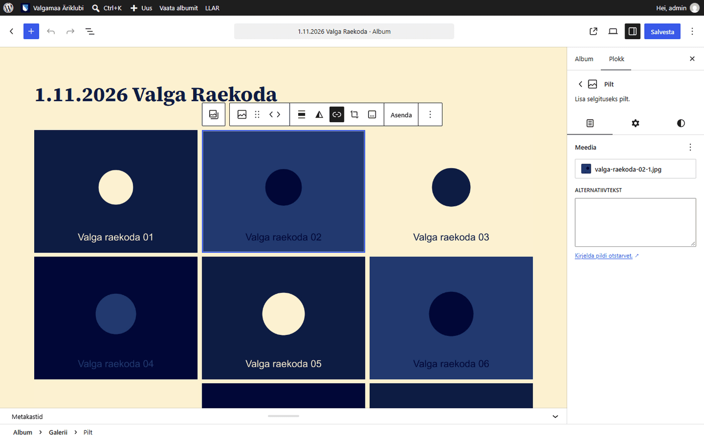

3. **Pildi eemaldamine albumist:** klõpsa pildil, vajuta tööriistaribal kolme punkti (**⋮**, "Valikud") ja vali kõige alt **"Kustuta"**. Pilt kaob albumist, aga jääb alles **Meedia** alla. Kui soovid pildi päriselt kustutada, ava **Meedia**, vali pilt ja vajuta **"Kustuta jäädavalt"**.
4. **Allkiri:** klõpsa pildil, vajuta tööriistaribal **"Lisa pealdis"** ja kirjuta pildi alla tekst (näiteks inimeste nimed). Allkiri on valikuline.
5. **Piltide lisamine olemasolevasse albumisse:** vali galerii plokk (vt [peatükk 3](#3-uue-galerii-albumi-lisamine), samm 6), vajuta tööriistaribal **"Lisa"** ja seejärel **"Laadi üles"** või **"Ava meediateek"**.
6. Vajuta paremal üleval **"Salvesta"**, et muudatused salvestada.

**Albumi kustutamine:** **Galerii albumid** → too hiir albumi peale → **"Prügikasti"**. Prügikastist saab albumi 30 päeva jooksul taastada.

---

## 5. Vanade albumite mustandid

Vanalt kodulehelt on üle toodud **76 albumi pealkirja mustanditena** (ilma piltideta). Need ei ole kodulehel nähtavad enne, kui need avaldatakse.

1. Vali **Galerii albumid** ja klõpsa nimekirja kohal lingil **"Mustandid"**. Näed kõiki vanu albumeid.

   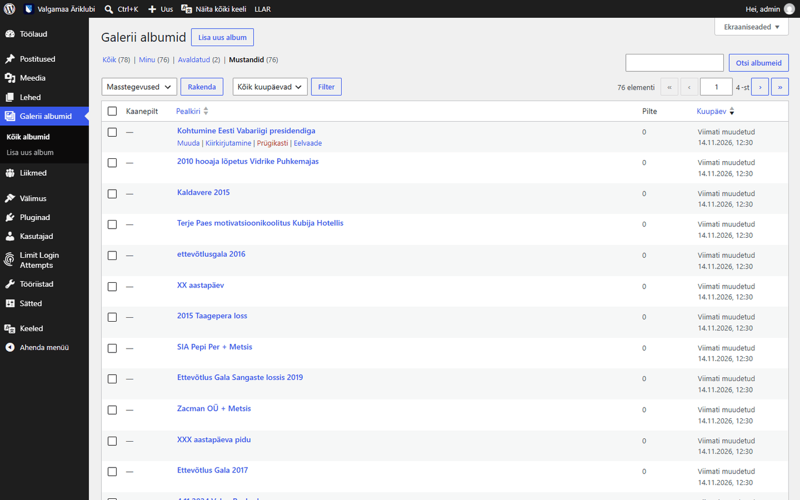

2. Ava album, millele sul on pildid olemas (**"Muuda"**).
3. Kontrolli **pealkirja** ja **kuupäeva** (real "Avalda"). Kuupäev peab olema ürituse kuupäev; paranda, kui vaja.
4. Lisa pildid ja kaanepilt nagu [peatükis 3](#3-uue-galerii-albumi-lisamine) (sammud 4–7). Vanades mustandites ei ole galerii plokki veel sees: vajuta üleval vasakul sinist **"+"** nuppu, kirjuta otsingusse **"Galerii"** ja vali plokk **Galerii**.
5. Vajuta **"Avalda"**.

Kui mõne vana albumi jaoks pilte ei ole ega tule, võid mustandi kustutada (**"Prügikasti"**).

---

## 6. Uudise või kuulutuse kirjutamine

Uudised ja kuulutused on **postitused**. Need ilmuvad lehel **Uudised** ja avalehel ("viimased uudised").

### Eestikeelne postitus

1. Vali **Postitused → Lisa postitus**.

   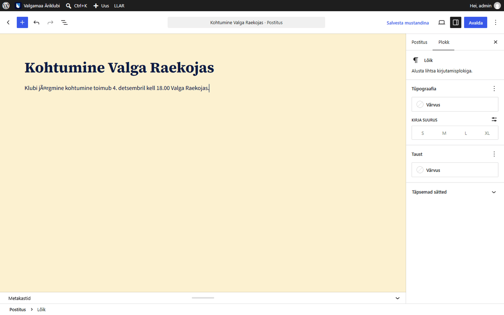

2. Kirjuta **pealkiri** ja **tekst**. Uue lõigu alustamiseks vajuta **Enter**. Pildi lisamiseks vajuta **"+"** ja vali plokk **"Pilt"**.
3. Paremal külgribal (vahekaart **"Postitus"**):
   - **Rubriigid:** vali **Uudised** või **Kuulutused** (ainult üks). Ära vali "Määratlemata".
   - **Keeled** → **Keel:** kontrolli, et valitud on **Eesti**.
   - **"Lisa katkend…"** (väljavõte, valikuline): 1–2 lauset, mis näidatakse uudiste nimekirjas. Kui jätad tühjaks, võetakse teksti algus.
   - **"Määra tunnuspilt"** (valikuline).
   - **Avalda → "Otsekohe"**: kui uudis on mõne ürituse kohta, võid valida ürituse kuupäeva (tänase või varasema; tulevane kuupäev muudab nupu nupuks "Järjekord").

   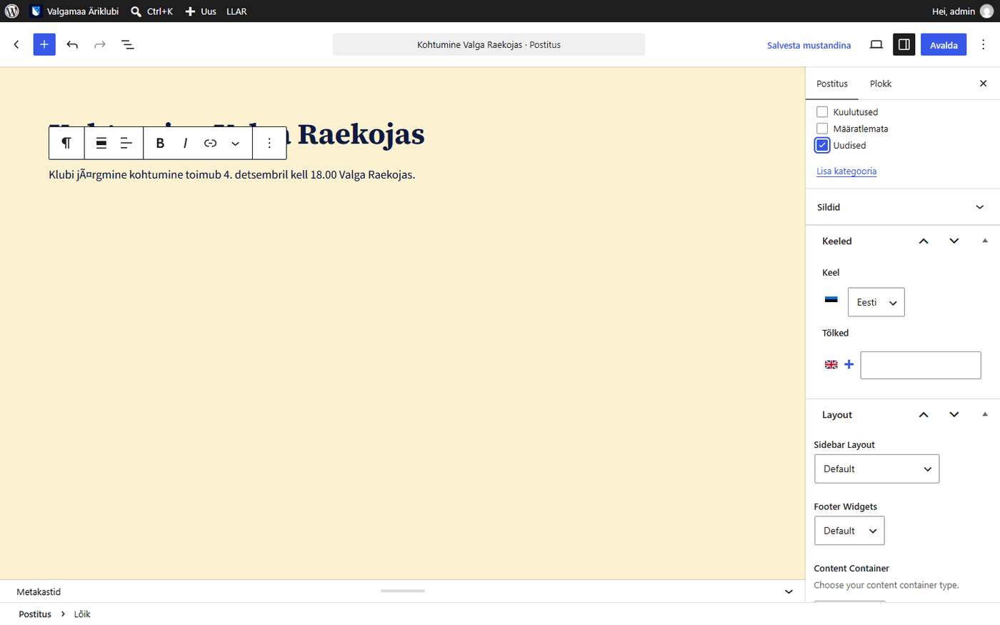

   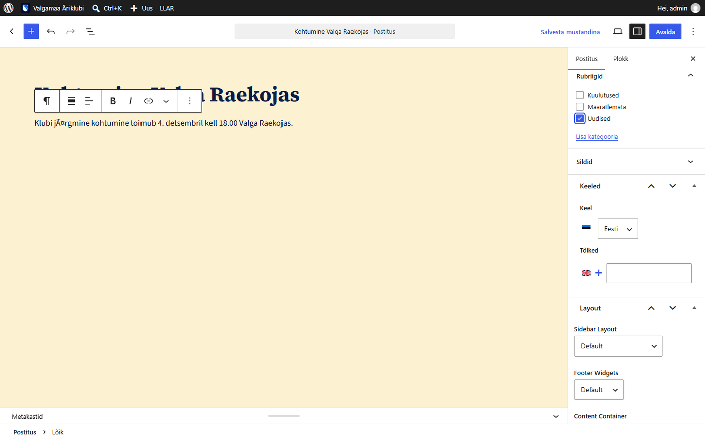

4. Vajuta **"Avalda"** ja kinnita veel kord **"Avalda"**.

### Ingliskeelne tõlge (valikuline)

1. Ava eestikeelne postitus (**"Muuda"**).
2. Paremal külgribal jaotises **"Keeled"** on all **"Tõlked"**. Vajuta Briti lipu (English) kõrval olevale sinisele **"+"** märgile ("Lisa tõlge keeles English"). Kui tõlge on juba olemas, on "+" asemel pliiatsi ikoon ("Muuda tõlget").

   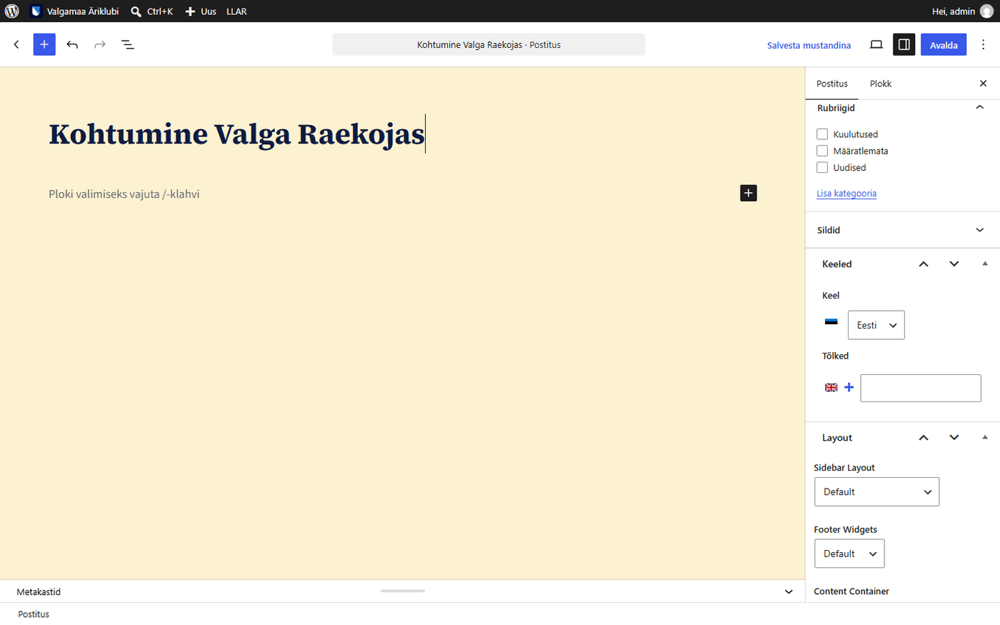

3. Avaneb uus postitus, mille keel on juba **English** ja mis on eestikeelsega seotud. Kirjuta ingliskeelne pealkiri ja tekst.
4. Vali rubriik **News** või **Announcements** (ingliskeelsed rubriigid).
5. Vajuta **"Avalda"** ja kinnita veel kord **"Avalda"**.

Kui tõlget ei ole, ei ilmu postitus ingliskeelsele lehele. See on lubatud.

**Postituse kustutamine:** **Postitused** → too hiir postituse peale → **"Prügikasti"**. Kustuta vajadusel eraldi ka ingliskeelne tõlge.

---

## 7. Liikmed

Liikmete nimekiri on lehel **Liikmed** ja see on **sama mõlemas keeles**. Lehe sisu ei pea muutma: nimekiri koostatakse automaatselt.

### Liikme lisamine

1. Vali **Liikmed → Lisa uus liige**.
2. **Pealkiri:** liikme nimi kujul **"Eesnimi Perenimi"**, näiteks `Hans Heinjärv`. Nimekiri sorditakse automaatselt **perekonnanime** (nime viimase sõna) järgi.
3. Kastis **"Ettevõte ja koduleht"** täida väljad **Ettevõte** ja **Koduleht** (koos `https://`-ga, näiteks `https://www.pindi.ee`). Koduleht ei ole kohustuslik.
4. **Logo või foto** (valikuline): paremal kastis **"Logo või foto"** vajuta **"Määra logo või foto"**.
5. Vajuta paremal **"Avalda"**. (Kaste "Postituse atribuudid" ja "Lisaväljad" ei pea täitma.)

   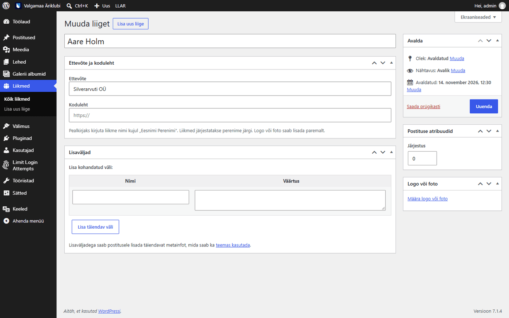

### Liikme muutmine või eemaldamine

1. Vali **Liikmed**. Nimekiri on mitmel lehel (20 liiget lehel); liikme leiad kiiresti paremal üleval otsingukastiga (**"Otsi liikmeid"**).

   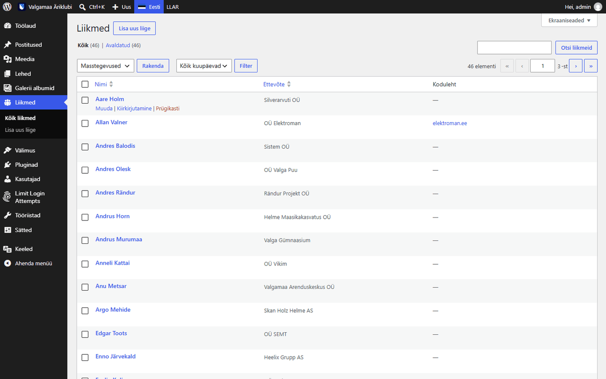

2. Too hiir nime peale:
   - **"Muuda"** – muuda andmeid ja vajuta **"Uuenda"**.
   - **"Prügikasti"** – liige eemaldatakse kodulehelt.

Kui avalehel on liikmete arv (näiteks "üle 40 ettevõtte juhi"), uueneb see automaatselt, kui seal on kasutatud lühikoodi `[ak_member_count]`.

---

## 8. Ajaloo tabel (kohtumised)

Lehel **Ajalugu** olev kohtumiste tabel on **sünkroonitud muster** nimega **"Ajaloo tabel"**. See tähendab, et tabel on üks ja sama nii eesti- kui ka ingliskeelsel ajalooleheküljel. Muudad seda ühes kohas ja muudatus ilmub mõlemale lehele.

### Tabeli avamine

1. Mustrite nimekirja ei ole vasakus menüüs. Ava veebilehitsejas otse aadress **`https://<domeen>/wp-admin/edit.php?post_type=wp_block`** (lehe pealkiri on **"Mustrid"**; tasub see järjehoidjasse lisada).
2. Too hiir **"Ajaloo tabel"** peale ja vajuta **"Muuda"**.

   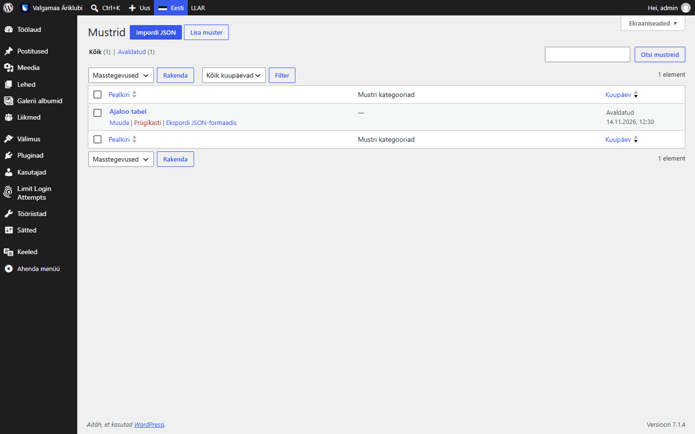

   Teine võimalus: ava **Lehed → Ajalugu**, klõpsa tabelil ja vajuta tööriistaribal **"Muuda originaali"**.

   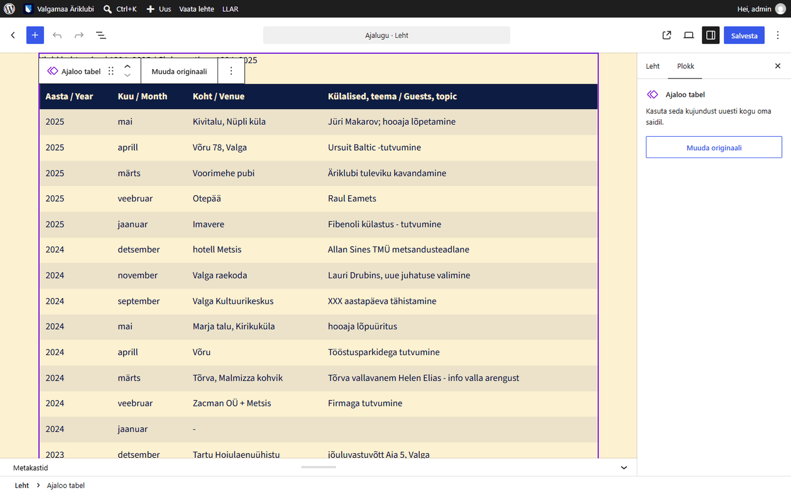

### Uue kohtumise lisamine

Uusimad kohtumised on tabelis **kõige üleval**.

1. Klõpsa tabeli **esimese andmerea** (päise all oleva rea) mõnes lahtris.
2. Vajuta tööriistaribal tabeli ikoonile **"Muuda tabelit"** ja vali **"Lisa ette rida"**.

   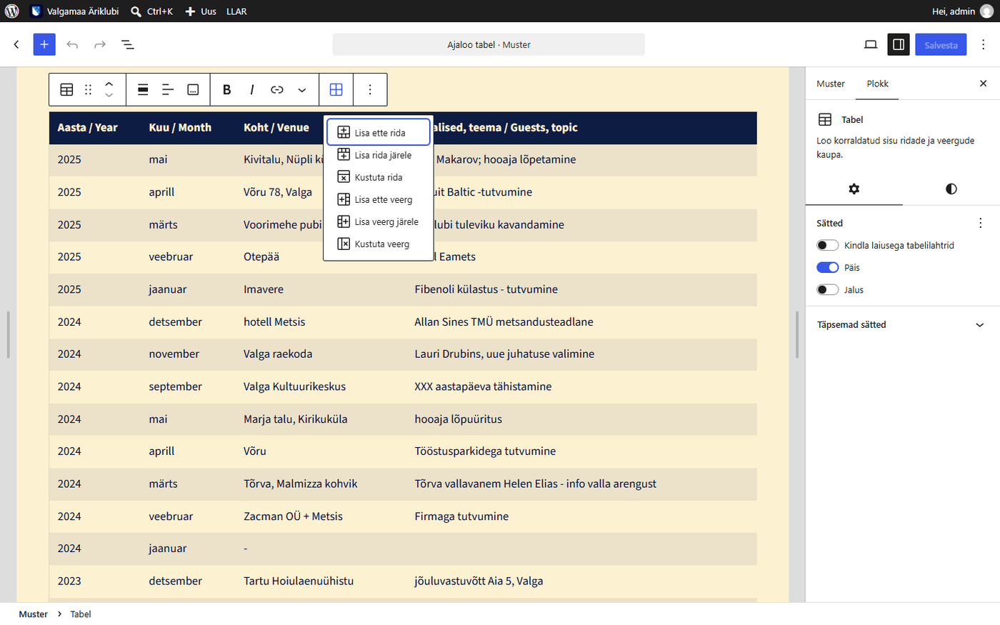

3. Täida uue rea lahtrid: **Aasta**, **Kuu**, **Koht**, **Külalised, teema**.
4. Vajuta paremal üleval **"Salvesta"**.
5. Kontrolli kodulehel lehte **Ajalugu** ja ingliskeelset lehte **History**: uus rida on mõlemas.

**Rea kustutamine:** klõpsa real → **"Muuda tabelit"** → **"Kustuta rida"**.

Ära kustuta kogu tabeli plokki ega mustrit ennast, siis kaob tabel mõlemalt lehelt.

---

## 9. Kontaktandmed jaluses

Iga lehe allosas (jaluses) on klubi kontaktandmed ja lühike tutvustus. Need on **moodulid** (vidinad) ning **eesti ja inglise keele jaoks on eraldi moodulid**.

Mooduleid saab muuta ainult **administraator**. Kui sul on toimetaja konto ja kontaktandmed muutuvad, anna sellest teada administraatorile.

1. Vali **Välimus → Moodulid**. (Kui üleval ilmub punane teade "Pluginat "generatepress-content-width" ei saa … kuvada", võid selle sulgeda – see ei mõjuta midagi.)
2. Ava jaluse ala: **"Footer Widget 1"** – kontaktid, **"Footer Widget 2"** – tutvustus. Igas alas on kaks moodulit: esimene on **eestikeelne** (pealkiri "Kontakt" / "Valgamaa Äriklubi"), teine **ingliskeelne** (pealkiri "Contact" / "Valgamaa Äriklubi" ingliskeelse tekstiga). Mooduli keelt siin ekraanil ei näidata, see on salvestatud mooduli juurde ja säilib muutmisel.

   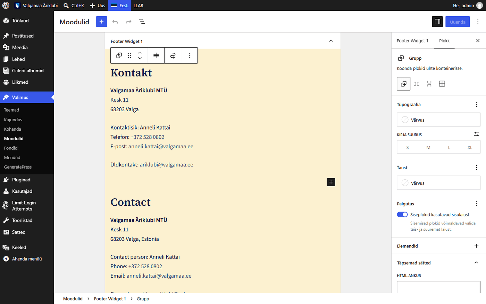

3. Muuda teksti **mõlemas** moodulis (eesti ja inglise), et andmed oleksid ühesugused.
4. Telefoninumbri ja e-posti lingid: kui muudad numbrit või aadressi, muuda ka lingi sihtkohta (`tel:+3725280802`, `mailto:nimi@valgamaa.ee`). Lingi muutmiseks klõpsa lingiga tekstil ja vajuta tööriistaribal lingi ikooni.
5. Vajuta paremal üleval **"Uuenda"**. All ilmub teade "Moodulid salvestatud."
6. Kontrolli kodulehel nii eesti- kui ka ingliskeelset lehte: jaluses on ainult selle keele kontaktid.

**Ära lisa** jaluse aladesse uusi plokke ega kustuta olemasolevaid: uuel plokil ei ole keelt ja see ilmuks mõlemas keeles korraga.

---

## 10. Lehtede muutmine

Lehti (Avaleht, Liikmed, Uudised, Ajalugu, Galerii, Privaatsus) muudad menüüs **Lehed**. Igal lehel on eesti- ja ingliskeelne versioon; muuda mõlemat, kui muudad sisu.

1. Vali **Lehed**, too hiir lehe peale ja vajuta **"Muuda"**.
2. Muuda teksti nagu tavalises tekstitöötluses.
3. Vajuta paremal üleval **"Salvesta"**.

### Mida mitte rikkuda

Mõnel lehel on **lühikoodid** – nurksulgudes tekst. Need näitavad kodulehel automaatselt nimekirju. **Ära kustuta ega muuda neid**:

| Lühikood | Mida see teeb |
|---|---|
| `[ak_members]` | Liikmete nimekiri (leht Liikmed) |
| `[ak_albums count="12" pagination="yes"]` | Albumite nimekiri (leht Galerii) |
| `[ak_albums count="3" pagination="no"]` | 3 viimast albumit (Avaleht) |
| `[ak_latest_news count="3"]` | 3 viimast uudist (Avaleht) |
| `[ak_member_count]` | Liikmete arv (tekstis) |

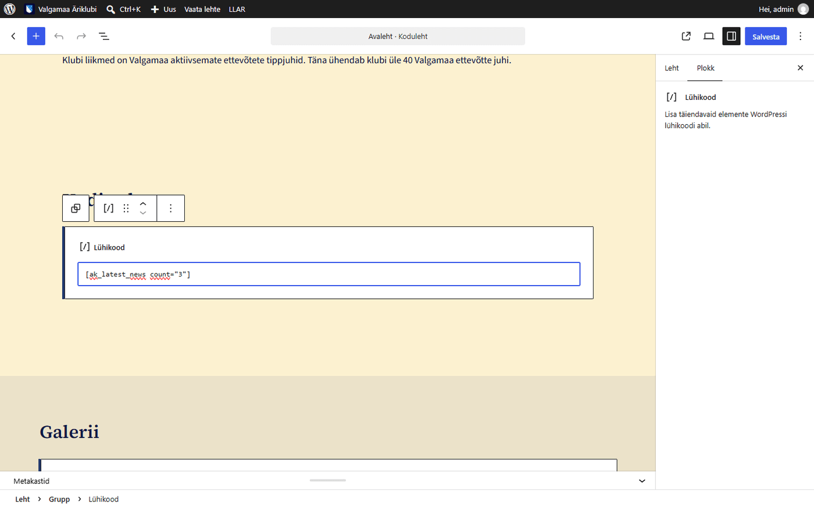

Samuti ära kustuta lehelt **Ajalugu** tabeli plokki (see on muster, vt [peatükk 8](#8-ajaloo-tabel-kohtumised)).

Lehtede **aadresse** (nt `/liikmed/`) ja **pealkirju** menüüs ära muuda ilma administraatoriga rääkimata.

Kui midagi läks valesti, saab lehe varasema versiooni taastada: paremal külgribal (vahekaart "Leht") real **"Versioonid"** → vali varasem versioon → **"Taasta see versioon"**. Rida "Versioonid" ilmub alles siis, kui lehte on vähemalt korra muudetud ja salvestatud.

---

## 11. Mida MITTE teha

- **Ära paigalda uusi pluginaid.** Koduleht on tehtud nii, et pluginaid juurde vaja ei ole. Iga lisaplugin on turvarisk ja vajab hooldust.
- **Ära vaheta teemat** (Välimus → Teemad) ega muuda teema seadeid. Kodulehe kujundus ja värvid kaovad.
- **Ära muuda Polylangi seadeid** (menüü **Keeled**). Keelte seadistus on tehtud üks kord ja selle muutmine võib rikkuda ingliskeelse lehe.
- **Ära muuda** menüüs **Sätted** midagi (eriti püsiviiteid ja lugemise sätteid), kui sa pole kindel.
- **Ära kustuta** lehti Avaleht, Liikmed, Uudised, Ajalugu, Galerii, Privaatsus ega mustrit "Ajaloo tabel".
- **Ära kustuta** uudiste kategooriaid Uudised/News ja Kuulutused/Announcements.
- **Ära jaga** oma kasutajakontot teistega. Uus haldaja saab oma konto administraatorilt.
- Uuendused (WordPress, pluginad, teemad) **toimuvad automaatselt**. Midagi pole vaja käsitsi uuendada.

---

## 12. Kui midagi läheb katki

1. **Ära paanitse.** Kodulehest tehakse automaatselt varukoopiaid.
2. Kui viga tekkis pärast sinu muudatust, proovi lehe varasem versioon taastada (**"Versioonid"**, vt [peatükk 10](#10-lehtede-muutmine)).
3. Kirjuta üles, **mida sa tegid**, **millal** ja **mis lehel** viga on (aadress, kuvatõmmis).
4. Võta ühendust kodulehe **administraatoriga**: ______________________ (nimi, telefon, e-post; täidetakse üleandmisel).
5. Kui koduleht ei avane üldse või administraatorit ei saa kätte, võta ühendust **Zone'i klienditoega** (Zone on kodulehe majutaja):
   - klienditugi: **my.zone.eu** kaudu või e-post **info@zone.ee**
   - telefon: **+372 696 3300**

<!--
Screenshot placeholders used in this guide (docs/img/):
- img/admin-login.png
- img/admin-dashboard.png
- img/admin-profile-password.png
- img/admin-album-new.png
- img/admin-album-title-date.png
- img/admin-gallery-block-insert.png
- img/admin-gallery-upload.png
- img/admin-gallery-settings-link.png
- img/admin-gallery-link-menu.png
- img/admin-album-featured-image.png
- img/admin-album-publish.png
- img/front-album-desktop-et.png
- img/front-lightbox-desktop-et.png
- img/admin-gallery-reorder.png
- img/admin-album-list-drafts.png
- img/admin-post-new.png
- img/admin-post-category.png
- img/admin-post-language.png
- img/admin-post-add-translation.png
- img/admin-member-edit.png
- img/admin-member-list.png
- img/admin-patterns-list.png
- img/admin-history-synced-block.png
- img/admin-history-table-add-row.png
- img/admin-widgets-footer.png
- img/admin-page-shortcodes.png
QA (WS-G, 2026-11-14): all screenshots captured from the local Estonian WordPress 7.1.4 admin; labels in
this guide were checked against it (chapter 3 was followed literally by an Editor account, 22 photos in
one upload). Still to verify by the owner: Zone support phone/email (+372 696 3300, info@zone.ee).
-->
