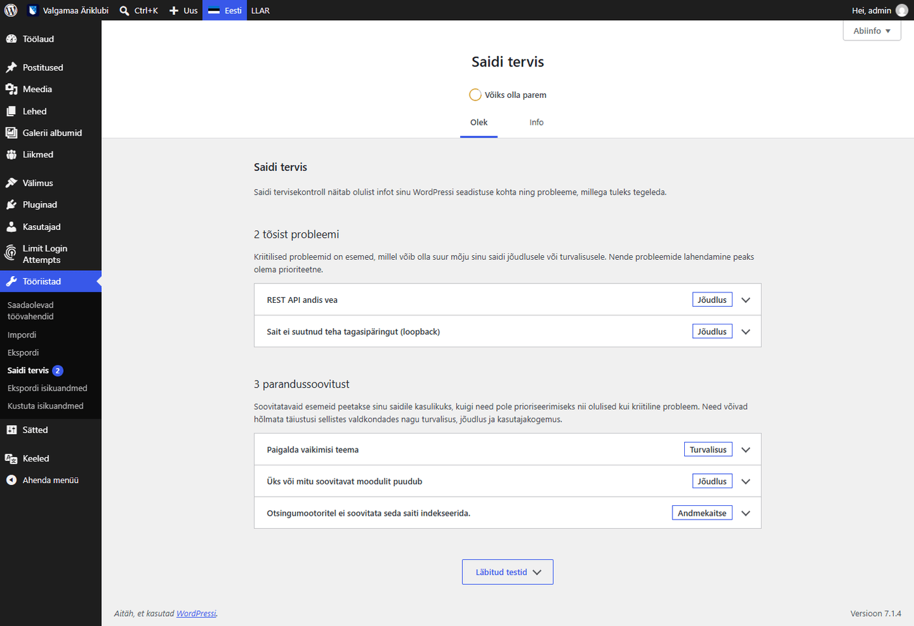
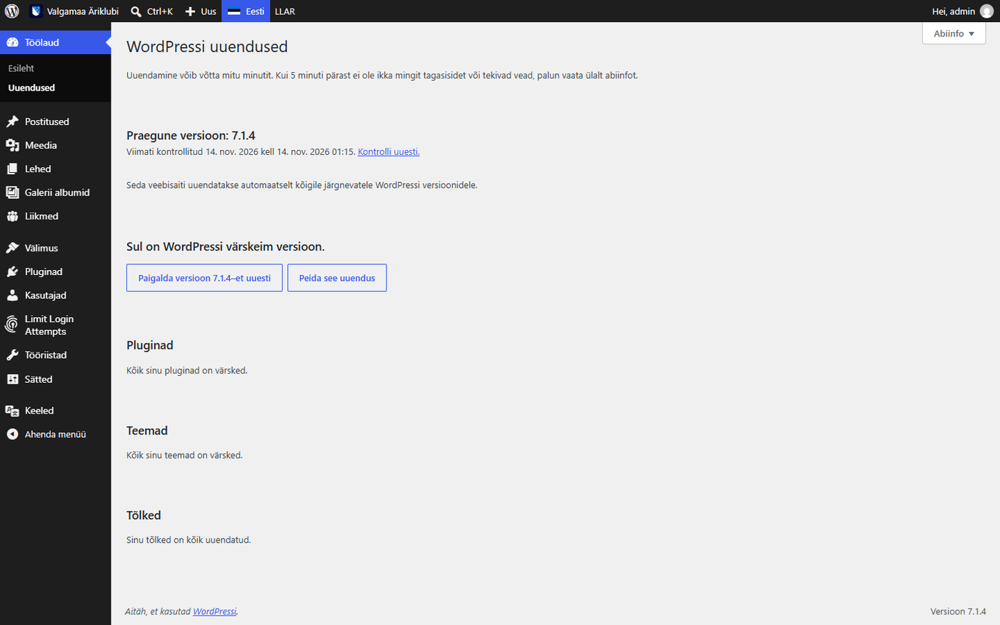

# Deploying to Zone.ee (one-time setup)

Audience: the owner, once. Language: English.

This guide builds the production site on a Zone.ee virtual server with the same provisioning script that is used locally (`scripts/setup.sh`). Nothing is migrated from the local site; the content comes from the repository's `content/` and `brand/` folders. Images in gallery albums are uploaded by the club administrators after launch.

`<domain>` stands for the final domain (for example `ariklubi.ee`; see PLAN.md §8, open question 1). Steps that could not be verified against the current Zone panel are marked **(verify in panel)**; menu names in the Zone panel change from time to time.

Before you start, have ready:

- access to the Zone account that owns (or will own) the domain and the virtual server: https://my.zone.eu
- a password manager to store the credentials you create (they are then listed, without secrets, in [`HANDOVER.md`](HANDOVER.md))
- this project folder on your computer
- Git for Windows, if it is not installed yet: https://git-scm.com/download/win

Do these in order: [A. Create an SSH key pair](#a-create-an-ssh-key-pair), [B. Where the files live](#b-where-the-files-live), then sections 1–11.

---

## A. Create an SSH key pair

Do this once, on the computer you will use to log in to the server. Windows 10 and 11 already include the OpenSSH client. The commands below are for Windows PowerShell (Start menu → type `PowerShell` → Enter). On macOS or Linux the same `ssh-keygen` command works in Terminal, and the public key is `~/.ssh/id_ed25519.pub`.

Zone accepts an Ed25519 public key in a single line that starts with `ssh-ed25519` ([Zone SSH access policy](https://www.zone.ee/help/en/kb/zone-ssh-access-policy/)).

1. Check whether you already have a key. In PowerShell:

   ```powershell
   Test-Path $env:USERPROFILE\.ssh\id_ed25519.pub
   ```

   If this prints `True`, skip to step 3 and reuse that key. Do not run `ssh-keygen` again: it will ask to overwrite the old key, and the old public key would stop working everywhere you have already installed it.

2. Generate a new key. The `-C` comment is a label so you can recognise the key later; it is not a password.

   ```powershell
   ssh-keygen -t ed25519 -C "ariklubi owner laptop" -f "$env:USERPROFILE\.ssh\id_ed25519"
   ```

   When it asks for a passphrase, type one and store it in the password manager. You will type it when you connect. An empty passphrase works, but anyone who copies the private key file can then log in to the server.

   If PowerShell says `ssh-keygen` is not recognised: Settings → System → Optional features → View features → **OpenSSH Client** → Install. Then open a new PowerShell window and repeat this step.

3. Show the public key and copy the whole line (it is one line, starting with `ssh-ed25519` and ending with the comment):

   ```powershell
   Get-Content $env:USERPROFILE\.ssh\id_ed25519.pub
   ```

4. Leave the private key where it is.

   | File | What it is | What you do with it |
   |---|---|---|
   | `C:\Users\<you>\.ssh\id_ed25519.pub` | Public key | Paste into the Zone panel in [step 1.4](#1-prepare-the-virtual-server-in-myzoneeu). Safe to copy. |
   | `C:\Users\<you>\.ssh\id_ed25519` | Private key | Stays on this computer. Never email it, never upload it, never commit it, never paste it into GitHub or into the Zone panel. |

   The Zone panel wants the public line only. If the text you are about to paste contains `BEGIN OPENSSH PRIVATE KEY`, that is the private key: stop, and copy the `.pub` file instead.

5. Optional: remember the passphrase for this Windows login, so later `ssh` commands do not ask for it every time. Approving the service may ask for administrator permission. If this fails, skip it and type the passphrase when `ssh` asks.

   ```powershell
   Get-Service ssh-agent | Set-Service -StartupType Manual
   Start-Service ssh-agent
   ssh-add $env:USERPROFILE\.ssh\id_ed25519
   ```

You add this public key to the server in step 1.4, after the virtual server exists. The first real login is in [section 3](#3-connect-over-ssh-and-check-wp-cli).

## B. Where the files live

Two different kinds of files, managed in two different places:

| Files | Where they live after launch | How you change them |
|---|---|---|
| Pages, news, members, albums, photos, menus, footer widgets | On the server only: the WordPress database, plus uploaded images in `wp-content/uploads` | WordPress admin (`/wp-admin/`). Club editors do this. Nothing is copied from GitHub. |
| Theme, must-use plugin, `scripts/`, seed files in `content/` and `brand/` | A **private GitHub repository**, plus one copy on the server at `~/ariklubi-src` (outside the web root) | You edit on your computer, push to GitHub, then pull on the server. Rare. See [Updating the theme or mu-plugin later](#updating-the-theme-or-mu-plugin-later-rare). |
| Passwords, the private SSH key, `.env`, database dumps | Password manager, and on the server only where WordPress needs them | Never in GitHub. `.env`, `.runtime/` and `.tools/` are already listed in `.gitignore`. |

**Create a private GitHub repository. Do not add a GitHub Actions deployment.**

A private repository is the backup of the source code, so the only copy is not the laptop. The server pulls from it. That is the whole of the file workflow.

GitHub Actions is the wrong tool for this site:

- Actions can only copy files that are in the repository. News, members and photos are not in the repository; editors change them in WordPress. An Action cannot publish them, and it must not try.
- Putting a new theme file on the server is two commands (`git pull` and `rsync`), and it happens rarely. The site is built so that nobody maintains code after launch (see `PLAN.md` §1).
- Zone allows SSH only from addresses you list, unless you turn that restriction off ([Zone's SSH article](https://www.zone.ee/help/en/kb/establishing-an-ssh-connection/)). GitHub-hosted runners use a large set of addresses that changes over time. An Action would mean either keeping that list up to date, or leaving SSH open to the whole internet and storing a server private key in GitHub's secrets. Both are more to look after than a login from your own computer.
- A workflow that runs `scripts/setup.sh` on every push can overwrite settings and imported items. The manual update below does not run that script.

### B.1 Create the private repository and push (on your computer)

1. Sign in at https://github.com and create a new repository. Name it `ariklubi` (or similar). Set visibility to **Private**. Do not add a README, a `.gitignore` or a licence: this folder already has them. An empty repository is what you want, so the first push is a simple upload of this project.
2. In PowerShell, go to this project folder (the one that contains `PLAN.md`):

   ```powershell
   cd C:\Users\kevin\Documents\2riklubi
   git status
   ```

   If Git says `not a git repository`, create the first commit. If `git status` already lists files, skip the `git init` line and continue with `git add`.

   ```powershell
   git init
   git add .
   git status
   ```

   Read the list. `.env`, `.runtime/` and `.tools/` must not appear. `id_ed25519` must not appear. If a secret is listed, do not commit; add that path to `.gitignore` and run `git add .` again.

   ```powershell
   git commit -m "Initial commit of the Ariklubi site source."
   ```

3. Connect the folder to GitHub and push. Replace `<you>` with your GitHub username. Use the HTTPS address GitHub shows under "Code"; HTTPS asks you to sign in through the browser (Git Credential Manager, installed with Git for Windows) and does not need a second SSH key.

   ```powershell
   git remote add origin https://github.com/<you>/ariklubi.git
   git branch -M main
   git push -u origin main
   ```

4. On the GitHub website, open the repository and confirm two things: the visibility badge says **Private**, and the file list includes `wp-content/`, `content/`, `scripts/` and `docs/`. It must not include `.env`.

Write the repository URL into [`HANDOVER.md`](HANDOVER.md) when you reach section 11. The copy on the server is created in [section 4](#4-upload-the-code-outside-the-web-root), after SSH works.

---

## 1. Prepare the virtual server in my.zone.eu

1. Log in to **my.zone.eu** and open the **virtual server** (Virtuaalserver) for `<domain>`.
2. **PHP version and limits** (under the web server / PHP settings of the virtual server **(verify in panel)**):
   - PHP version: **8.3**
   - `upload_max_filesize` = **64M**
   - `post_max_size` = **64M**
   - `memory_limit` = **256M**

   If the panel does not offer these values, they can usually be set in a `.user.ini` file in the web root **(verify in panel / with Zone support)**:

   ```ini
   upload_max_filesize = 64M
   post_max_size = 64M
   memory_limit = 256M
   ```

   *Screenshot to be added (Zone panel: PHP settings); no Zone access during QA.*

3. **Database:** create a MariaDB (MySQL) database and a user with full rights on it (under Andmebaasid / Databases **(verify in panel)**). Write down:
   - database name (Zone usually prefixes it, for example `d12345_ariklubi`) **(verify in panel)**
   - database user and password (store the password in the password manager)
   - database host as shown in the panel (often not `localhost` on Zone) **(verify in panel)**

   *Screenshot to be added (Zone panel: creating the database); no Zone access during QA.*

4. **SSH.** In the virtual server menu, open **SSH** **(verify in panel)**. Zone's own steps are in [Establishing an SSH connection](https://www.zone.ee/help/en/kb/establishing-an-ssh-connection/).

   1. **Who may connect.** Under **IP Whitelist**, choose whether SSH is limited to listed addresses. The key from section A is required either way; Zone does not offer an SSH password. For a single owner whose home address changes, allow connections from any address so a new internet address does not lock you out. If you would rather keep the list, click **+ Add new IP**, paste your current public address (search the web for "what is my ip") and a comment such as "home". When SSH later refuses the connection, add the new address here before changing anything else.
   2. **Public key.** Open **Public keys** → **+ Add New Public Key**. Paste the single line from section A (`Get-Content $env:USERPROFILE\.ssh\id_ed25519.pub`). It must start with `ssh-ed25519`. Add a comment such as "owner laptop" and click **Add**. Zone copies the key to the server within about 10 minutes.
   3. Write down the SSH username and host shown on that same page. The username looks like `virt` plus digits (for example `virt33390`). You need both in section 3.

   *Screenshot to be added (Zone panel: adding the SSH key); no Zone access during QA.*

## 2. DNS and HTTPS

1. Point the domain's DNS at the virtual server. If the domain is registered and its DNS hosted at Zone, the records are usually created automatically when the domain is attached to the virtual server **(verify in panel)**. Otherwise set the `A`/`AAAA` records (both `<domain>` and `www.<domain>`) at the DNS provider to the addresses shown in the panel.
2. Wait until `<domain>` resolves to the server (`nslookup <domain>`).
3. Issue a free **Let's Encrypt** certificate for `<domain>` and `www.<domain>` in the panel's SSL/TLS section **(verify in panel)**.
4. Turn on **"force HTTPS"** (redirect http → https), if the panel offers it **(verify in panel)**. Decide on one canonical host (with or without `www`) and redirect the other one to it.

   *Screenshot to be added (Zone panel: Let's Encrypt certificate); no Zone access during QA.*

## 3. Connect over SSH and check WP-CLI

1. On your computer, in PowerShell, connect with the username and host from step 1.4. The first time, SSH prints the server fingerprint and asks if you trust it: type `yes` and press Enter. Later connections ask for the passphrase from section A, unless you saved it with `ssh-add`.

   ```powershell
   ssh <ssh-user>@<ssh-host>
   ```

2. Find the web root. On Zone it is typically `~/domeenid/www.<domain>/htdocs` **(verify in panel)**. The rest of this guide uses:

   ```bash
   export WP_PATH=~/domeenid/www.<domain>/htdocs
   ```

3. Check WP-CLI (normally available on Zone servers as `wp`):

   ```bash
   wp --info
   ```

   If `wp` is not found, download it into your home directory and use `WP_CLI="php ~/wp-cli.phar"` in step 5:

   ```bash
   curl -o ~/wp-cli.phar https://raw.githubusercontent.com/wp-cli/builds/gh-pages/phar/wp-cli.phar
   php ~/wp-cli.phar --info
   ```

4. Check that the command-line PHP is 8.3 (`php -v`). If it differs from the web PHP version, ask Zone support which binary to use **(verify with Zone support)**.

## 4. Upload the code (outside the web root)

Keep the repository **outside** the public web root, so that `scripts/` and `content/` are never reachable from the web. Only the theme and the mu-plugin are copied into WordPress.

1. On the server, check that Git is available:

   ```bash
   git --version
   ```

   If the command is missing, skip steps 2–5 and use the SFTP fallback at the end of step 5. Ask Zone support whether Git can be used on this virtual server **(verify with Zone support)**.

2. Create a **second** key, on the server, that may only read this one GitHub repository. This is not the key from section A. That private key stays on your computer; this one never leaves the server, and GitHub will be told it cannot push.

   ```bash
   mkdir -p ~/.ssh && chmod 700 ~/.ssh
   ssh-keygen -t ed25519 -f ~/.ssh/id_ed25519_github -C "zone-ariklubi-readonly" -N ""
   cat ~/.ssh/id_ed25519_github.pub
   ```

   Copy the printed line (it starts with `ssh-ed25519`).

3. On GitHub, open the repository → **Settings** → **Deploy keys** → **Add deploy key**. Title it `Zone virtual server`, paste the line, and leave **Allow write access** unticked. Add the key.

4. Tell the server to use that key for GitHub, then confirm the login. GitHub prints a success sentence and then closes the connection; that closing message is normal.

   ```bash
   cat >> ~/.ssh/config << 'EOF'
   Host github.com
     HostName github.com
     User git
     IdentityFile ~/.ssh/id_ed25519_github
     IdentitiesOnly yes
   EOF
   chmod 600 ~/.ssh/config ~/.ssh/id_ed25519_github
   ssh -T git@github.com
   ```

   The reply you want contains `successfully authenticated`.

5. Clone into the home directory, outside the web root. Replace `<you>` with the GitHub username:

   ```bash
   git clone git@github.com:<you>/ariklubi.git ~/ariklubi-src
   ```

   **SFTP fallback** (only if `git` is not available). Use an SFTP client such as FileZilla with protocol SFTP, the username and host from step 1.4, and the **private** key file `C:\Users\<you>\.ssh\id_ed25519` (Zone's [SFTP article](https://www.zone.ee/help/en/kb/establishing-an-sftp-connection/)). Upload these folders into `~/ariklubi-src/`, keeping the same layout: `wp-content/themes/ariklubi`, `wp-content/mu-plugins`, `content/`, `brand/` and `scripts/`. Do not upload `.env`, `.runtime/` or `.tools/`. Later updates are a fresh upload of the theme and mu-plugin folders instead of `git pull`.

6. If WordPress core is not in the web root yet, `setup.sh` will download it in step 5 (`wp core download --locale=et`). The theme and mu-plugin are copied after that, in step 5.3.

## 5. Run the provisioning script

`setup.sh` reads its settings from environment variables:

| Variable | Required | Meaning |
|---|---|---|
| `SITE_URL` | yes | `https://<domain>` (the canonical host, with https) |
| `ADMIN_USER` | yes | Administrator login (the owner's emergency account; not `admin`) |
| `ADMIN_EMAIL` | yes | Administrator email (the club address, see go-live checklist) |
| `ADMIN_PASSWORD` | yes | A long random password (store it in the password manager) |
| `WP_CLI` | no | WP-CLI command, default `wp` (e.g. `php ~/wp-cli.phar`) |
| `WP_PATH` | no | WordPress directory (the web root) |
| `CONTENT_DIR` | no | Path to `content/` (e.g. `~/ariklubi-src/content`) |
| `BRAND_DIR` | no | Path to `brand/` (e.g. `~/ariklubi-src/brand`) |
| `DB_NAME`, `DB_USER`, `DB_PASSWORD`, `DB_HOST` | only on a fresh server | Used to create `wp-config.php` if it does not exist yet |
| `WP_ENVIRONMENT_TYPE` | no | Default `production` (search engines allowed). Use `staging` for a test copy. |
| `DB_PREFIX` | no | Table prefix used when creating `wp-config.php`, default `wp_` |
| `DISABLE_WP_CRON` | no | `1` writes `DISABLE_WP_CRON=true` into `wp-config.php` (same as step 5.2) |
| `SITE_TITLE` | no | Title for the first install only; the importer sets the real title |
| `AK_FORCE_UPDATE`, `AK_RECREATE_DELETED` | no | `1` = overwrite imported items edited in wp-admin / re-create imported items deleted in wp-admin. Never set these on the live site. |

If WordPress core files are missing in `WP_PATH`, the script downloads them (`wp core download --locale=et`). If `wp-config.php` is missing, it creates it from the `DB_*` values.

1. Download core and create the config (first run only). `setup.sh` would do this too, but the theme has to be copied into `wp-content/` (step 3) before the script activates it, so do it manually first:

   ```bash
   cd "$WP_PATH"
   wp core download --locale=et
   wp config create --dbname=<db_name> --dbuser=<db_user> --dbpass='<db_password>' --dbhost=<db_host> --locale=et
   ```

2. Make sure these constants are set in `wp-config.php` (run the lines; `wp config set` is safe to repeat):

   ```bash
   cd "$WP_PATH"
   wp config set WP_ENVIRONMENT_TYPE production
   wp config set DISALLOW_FILE_EDIT true --raw
   wp config set WP_AUTO_UPDATE_CORE true --raw
   wp config set DISABLE_WP_CRON true --raw
   ```

   `DISABLE_WP_CRON` turns off the visitor-triggered cron; the real server cron from step 6 replaces it.

3. Copy the theme and the mu-plugin into WordPress:

   ```bash
   mkdir -p "$WP_PATH/wp-content/themes" "$WP_PATH/wp-content/mu-plugins"
   rsync -a --delete ~/ariklubi-src/wp-content/themes/ariklubi/ "$WP_PATH/wp-content/themes/ariklubi/"
   rsync -a ~/ariklubi-src/wp-content/mu-plugins/ "$WP_PATH/wp-content/mu-plugins/"
   ```

   (If `rsync` is not available, use `cp -r`.)

4. Run the provisioning. Prefix the command with a space so that the password is not stored in the shell history (works in bash with the default `HISTCONTROL`), or `export` the variables from a file you delete afterwards:

   ```bash
    cd ~/ariklubi-src && \
    SITE_URL=https://<domain> \
    ADMIN_USER=<owner-login> \
    ADMIN_EMAIL=ariklubi@valgamaa.ee \
    ADMIN_PASSWORD='<long-random-password>' \
    WP_PATH="$WP_PATH" \
    CONTENT_DIR=~/ariklubi-src/content \
    BRAND_DIR=~/ariklubi-src/brand \
    DB_NAME=<db_name> DB_USER=<db_user> DB_PASSWORD='<db_password>' DB_HOST=<db_host> \
    WP_ENVIRONMENT_TYPE=production \
    bash scripts/setup.sh
   ```

   The script installs WordPress (Estonian, timezone Europe/Tallinn), GeneratePress, the `ariklubi` child theme, Polylang and Limit Login Attempts Reloaded, configures the languages (ET at `/`, EN at `/en/`), imports pages, news, members, album drafts, the history table, menus and footer widgets, sets the logo and site icon, and prints a summary of the created pages and their URLs.

5. Before launch it is safe to run the script again (for example after updating `content/`); it does not create duplicates. After launch, see the note at the end of this guide.

6. Open `https://<domain>/` and `https://<domain>/en/` and check that the site looks right.

## 6. Server cron (every 15 minutes)

WordPress auto-updates and scheduled tasks are run by a real cron job, so they work even when the site has few visitors.

1. In my.zone.eu, open the virtual server's cron section ("Crontab" / "Ajastatud tööd") **(verify in panel)**.
2. Add a job that runs **every 15 minutes** (`*/15 * * * *`):

   ```bash
   cd ~/domeenid/www.<domain>/htdocs && wp cron event run --due-now --quiet
   ```

   Use the full web root path from step 3.2. If WP-CLI is the phar, replace `wp` with `php ~/wp-cli.phar`. If the cron environment does not find `wp`, use its full path (`which wp` over SSH).

   *Screenshot to be added (Zone panel: cron job); no Zone access during QA.*

3. After an hour, check WordPress → Tööriistad → Saidi tervis (Tools → Site Health): there must be no warning about scheduled events being late.

## 7. Create the users

1. The Administrator account from step 5 belongs to the **owner** (emergency use only). Use a strong password and a personal or club email address.
2. Create one **Toimetaja (Editor)** account per club administrator: Kasutajad → Lisa kasutaja (Users → Add User), role **Toimetaja**. Editors can manage pages, news, members, albums and the history table, but not plugins, themes or settings.
3. Ask each editor to set their own password via the email link and to follow [`ADMIN-GUIDE.et.md`](ADMIN-GUIDE.et.md).
4. Footer widgets and menus (Välimus → Moodulid / Menüüd) can only be edited by an Administrator. If the club wants to change the contact details themselves, give one trusted person the Administrator role, or let the owner make those rare changes.

## 8. Backups

1. In my.zone.eu, check that **automatic backups** are enabled for the virtual server (files and databases) and note the retention period **(verify in panel)**.

   *Screenshot to be added (Zone panel: backups); no Zone access during QA.*

2. Do a test restore of **one file** (for example `wp-content/themes/ariklubi/style.css` into a temporary folder) to make sure you know how restoring works **(verify in panel)**.
3. Optional extra safety: a database dump before big changes:

   ```bash
   cd "$WP_PATH" && wp db export ~/ariklubi-backup-$(date +%F).sql
   ```

   Keep dumps outside the web root and delete old ones.

## 9. Smoke test and clean-up

1. Go through the go-live checklist below.
2. Make sure `scripts/` and `content/` are **not** in the public web root. If you uploaded them into `htdocs` by mistake, delete them there: `rm -rf "$WP_PATH/scripts" "$WP_PATH/content"`. Keeping the source in `~/ariklubi-src` (outside the web root) is fine.

### Go-live checklist

- [ ] HTTPS works; `http://` redirects to `https://`, and `www`/non-`www` redirect to one canonical host.
- [ ] Sätted → Lugemine (Settings → Reading): the box "Keela selle saidi indekseerimine otsimootorite poolt" (Discourage search engines from indexing this site) is **not** ticked.
- [ ] Sätted → Üldine (Settings → General): the admin email is the club address, and a test password-reset email arrives.
- [ ] The cron job is in place, and Tööriistad → Saidi tervis (Tools → Site Health) shows no cron problem and no critical issues.

  

- [ ] Töölaud → Uuendused (Dashboard → Updates) says automatic updates are enabled.

  

- [ ] `https://<domain>/xmlrpc.php` returns 403/405, and `https://<domain>/?author=1` does not reveal a username.
- [ ] Zone backups are confirmed (step 8).
- [ ] Editor accounts are created; the owner's Administrator account has a strong password.
- [ ] `scripts/` and `content/` are not in the public web root. The GitHub repository is private, and the server copy is `~/ariklubi-src`.
- [ ] A test album with 20 photos has been uploaded successfully (following the admin guide) and then deleted.
- [ ] Both languages work: `/`, `/en/`, the language switcher, the footer contacts.

## 10. Optional: redirect the old address

Ask the owner of `riiska.ee` to add a permanent (301) redirect from `ariklubi.riiska.ee` (all paths) to `https://<domain>/`. This keeps old links and search results working.

## 11. Handover

1. Fill in [`HANDOVER.md`](HANDOVER.md): who has which account, where the passwords are stored, the cron job, backups and support contacts. **Never write passwords into the repository.**
2. Hand the credentials over to the club through a password manager share or in person.
3. Give the club administrators [`ADMIN-GUIDE.et.md`](ADMIN-GUIDE.et.md) (English: [`ADMIN-GUIDE.en.md`](ADMIN-GUIDE.en.md)).

## Zone support

- Help desk: through my.zone.eu, or email **info@zone.ee** **(verify)**
- Phone: **+372 696 3300** **(verify)**
- Zone help pages: https://help.zone.eu **(verify)**

## Updating the theme or mu-plugin later (rare)

The site is designed so that this should not be needed. There is no GitHub Action to run (see [section B](#b-where-the-files-live)). Club content is changed in wp-admin and is not part of this update.

1. On your computer, in the project folder, commit and push:

   ```powershell
   git add .
   git status
   git commit -m "Describe the change."
   git push
   ```

   Check `git status` before the commit. `.env` and any private key must not be in the list.

2. On the server, pull that commit and copy only the theme and the mu-plugin into WordPress:

   ```bash
   cd ~/ariklubi-src && git pull
   rsync -a --delete ~/ariklubi-src/wp-content/themes/ariklubi/ "$WP_PATH/wp-content/themes/ariklubi/"
   rsync -a ~/ariklubi-src/wp-content/mu-plugins/ "$WP_PATH/wp-content/mu-plugins/"
   ```

   `WP_PATH` is the web root from section 3. If this is a new SSH session, set it again (`export WP_PATH=~/domeenid/www.<domain>/htdocs`). If you used the SFTP fallback in section 4, upload the two folders again instead of `git pull`.

Do **not** re-run `setup.sh` on the live site just to update code. By default the importer skips items that were edited or deleted in wp-admin, but the script re-applies the general settings (timezone, date format, closed comments, permalinks, search-engine visibility from `WP_ENVIRONMENT_TYPE`), the Polylang configuration, menus and imported items the club has not touched. Take a database dump first (step 8.3) if you ever have to run it again.

<!--
Screenshots used in this guide (docs/img/, captured locally): img/wp-site-health.png, img/wp-updates-auto.png.
Still to capture in the Zone panel at deployment: PHP settings, database, SSH key, Let's Encrypt, crontab, backups.
-->
