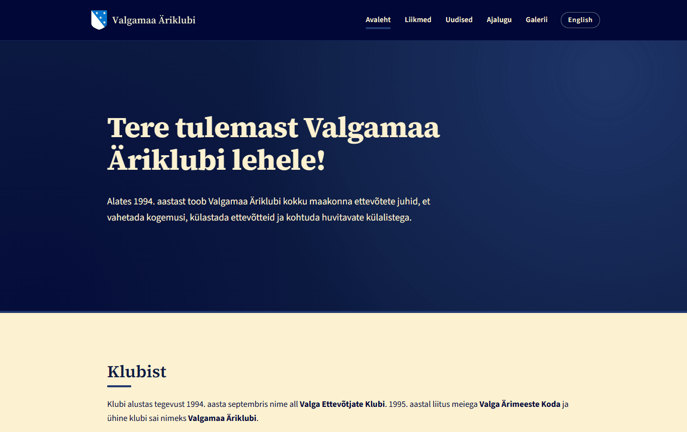
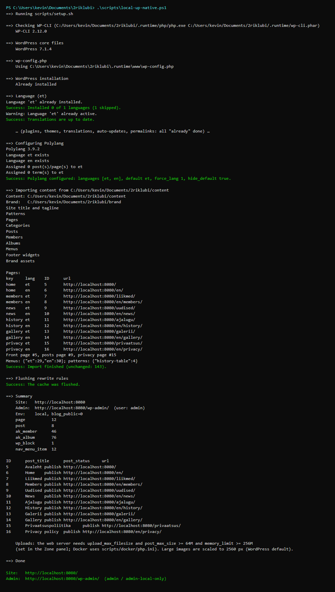

# Running the site locally

Audience: the developer/owner. Language: English.

The local site is built from scratch by the same provisioning script that is used on Zone (`scripts/setup.sh`), so nothing ever has to be migrated from local to production. Everything you see locally (pages, posts, members, album drafts, menus, footer widgets, logo) comes from the files in `content/` and `brand/`.

There are two ways to run it:

| | Option A: Docker (primary) | Option B: native Windows fallback |
|---|---|---|
| Script | `scripts/local-up.ps1` | `scripts/local-up-native.ps1` |
| Needs | Docker Desktop + WSL2 | Nothing extra (downloads portable PHP 8.3 + MariaDB 11) |
| Site | http://localhost:8080 | http://localhost:8080 |
| Mail catcher | Mailpit at http://localhost:8025 | None |
| Reset | `scripts/reset-local.ps1` | See [Resetting the native setup](#resetting-the-native-setup) |

Use Option A whenever Docker is available. Option B exists for machines where Docker/WSL cannot be installed (see `docs/DECISIONS.md`, "Deviations").

---

## 1. Prerequisites

1. **Git** for Windows: https://git-scm.com/download/win
2. For Option A only: **Docker Desktop** with the **WSL2** backend: https://www.docker.com/products/docker-desktop/
   - In Docker Desktop → Settings → General, make sure "Use the WSL 2 based engine" is ticked.
   - Start Docker Desktop and wait until it says "Engine running".
3. Clone the repository:

   ```powershell
   git clone <repository-url> 2riklubi
   cd 2riklubi
   ```

4. Create your local environment file from the template:

   ```powershell
   Copy-Item .env.example .env
   ```

   `.env` holds the local admin credentials and database settings. It is not committed. The defaults are fine for local use: `ADMIN_USER=admin`, `ADMIN_PASSWORD=admin-local-only` (the start script prints both at the end of the run). Change them in `.env` before the first run if you want other credentials.

## 2. Option A: Docker (primary)

1. Open PowerShell in the repository root.
2. Start everything:

   ```powershell
   .\scripts\local-up.ps1
   ```

   The script:
   1. runs `docker compose up -d` (services `db`, `wordpress`, `wpcli`, `mailpit`),
   2. waits until MariaDB accepts connections,
   3. runs `scripts/setup.sh` inside the `wpcli` container (installs WordPress in Estonian, GeneratePress, the `ariklubi` child theme, Polylang and Limit Login Attempts Reloaded; configures the languages; imports all content),
   4. prints the site URL and the admin credentials.

   *Screenshot to be added (output of local-up.ps1): the Docker path was not run on the QA machine, which has no Docker.*

3. Open the site: **http://localhost:8080** (Estonian) and **http://localhost:8080/en/** (English).

   

4. Log in at **http://localhost:8080/wp-admin/** with the credentials printed by the script (user from `.env`, default `admin`).
5. Mail sent by WordPress (password resets, notifications) does not leave your machine. Read it in **Mailpit: http://localhost:8025**.

   *Screenshot to be added (Mailpit inbox): the Docker path was not run on the QA machine, which has no Docker.*

### Running WP-CLI commands

The `wpcli` service is run on demand:

```powershell
docker compose run --rm wpcli wp plugin list
docker compose run --rm wpcli wp user list
docker compose run --rm wpcli wp user update admin --user_pass="new-password"
```

### Re-running the provisioning

`setup.sh` is idempotent: running it again updates existing content (matched by the `_ak_key` meta) and never creates duplicates. Running `.\scripts\local-up.ps1` again is the simplest way to do it.

### Stopping and resetting

- Stop (keeps data): `docker compose stop`
- Start again: `.\scripts\local-up.ps1`
- **Reset to a clean site** (deletes the database **and all uploaded images**, then rebuilds):

  ```powershell
  .\scripts\reset-local.ps1
  ```

## 3. Option B: native Windows fallback (no Docker)

1. Open PowerShell in the repository root (make sure `.env` exists, see step 1.4).
2. Run:

   ```powershell
   .\scripts\local-up-native.ps1
   ```

   On the first run the script downloads portable **PHP 8.3** and **MariaDB 11** into `.runtime/` (git-ignored; nothing is installed system-wide). It then starts MariaDB, downloads WordPress, runs the same `scripts/setup.sh` provisioning, and serves the site with PHP's built-in web server.

   

3. Open **http://localhost:8080** and log in at **http://localhost:8080/wp-admin/** with the credentials printed by the script.
4. Keep the PowerShell window open while you work: closing it (or pressing Ctrl+C) stops the web server. Run the script again to restart.

Differences from Docker:

- **No mail catcher.** Emails are not delivered anywhere. To change a password, use WP-CLI instead of "Lost your password?". The script prints how to call PHP and WP-CLI from `.runtime/` (check the script header/output for the exact command).
- PHP's built-in server is single-threaded, so it is slower than Apache, especially when uploading many images. It is fine for development and screenshots, not for load testing.
- Pretty permalinks work through a router script; if a URL unexpectedly returns 404, check the script output.

### Resetting the native setup

Stop the script, then delete the runtime data and run it again. Check the script header for the exact data folders; deleting the whole `.runtime/` folder is always safe (it is re-downloaded on the next run):

```powershell
Remove-Item -Recurse -Force .runtime
.\scripts\local-up-native.ps1
```

## 4. Logging in

| What | URL |
|---|---|
| Site (ET) | http://localhost:8080/ |
| Site (EN) | http://localhost:8080/en/ |
| Admin | http://localhost:8080/wp-admin/ |
| Mailpit (Docker only) | http://localhost:8025/ |

User: `ADMIN_USER` from `.env` (default `admin`). Password: `ADMIN_PASSWORD` from `.env` (default `admin-local-only`; the native script falls back to `admin` if it is empty). Both are printed at the end of the start script.

Note: Limit Login Attempts Reloaded is active locally too. If you lock yourself out, reset the password with WP-CLI, or reset the site.

## 5. Troubleshooting

**Port 8080 or 8025 is already in use.**
Find the process: `netstat -ano | findstr :8080`, then stop it in Task Manager (by PID). Alternatively change `WP_PORT` / `MAILPIT_PORT` in `.env` (Docker) and set the matching `SITE_URL`. If you change the port after the first setup, reset the site, because WordPress stores its URL in the database.

**`bash\r: No such file or directory` or `$'\r': command not found` when `setup.sh` runs.**
The shell scripts were checked out with Windows (CRLF) line endings. The repository's `.gitattributes` must contain:

```
*.sh text eol=lf
```

Then renormalise your working copy:

```powershell
git add --renormalize .
git checkout -- scripts
```

If you edit `.sh` files, make sure your editor saves them with LF line endings (in Cursor/VS Code, see the "CRLF/LF" indicator in the status bar).

**`running scripts is disabled on this system` (PowerShell execution policy).**
Run the script once with a bypass:

```powershell
powershell -ExecutionPolicy Bypass -File .\scripts\local-up.ps1
```

or allow local scripts for your user: `Set-ExecutionPolicy -Scope CurrentUser RemoteSigned`.

**Docker: `error during connect` / `The system cannot find the file specified`.**
Docker Desktop is not running. Start it and wait for "Engine running".

**Docker: the script waits forever for the database.**
Check the logs with `docker compose logs db`. If the volume is corrupted from an earlier run, run `.\scripts\reset-local.ps1`.

**Uploads fail with large images.**
Local PHP upload limits are set by the environment (64 MB is the target, the same as on Zone). Resize images to max 2560 px on the long edge before uploading; WordPress scales bigger images down anyway.

**The site shows the wrong language or `/en/` returns 404.**
Re-run the provisioning (`.\scripts\local-up.ps1`); it re-applies the Polylang configuration and the permalinks. If that does not help, go to Seaded → Püsiviited (Settings → Permalinks) and click "Salvesta muudatused" once to flush the rewrite rules.

<!--
Screenshots used in this guide (docs/img/):
- img/local-site-home.png
- img/local-native-output.png (rendered from the native setup log)
Still to capture on a machine with Docker: local-up.ps1 output, Mailpit inbox.
-->
