# QA report (WS-G, integration and QA)

Date: 2026-11-14. Tester: WS-G (automated browser checks with Chrome/puppeteer, Lighthouse, WP-CLI, plus manual review of screenshots).

## Test environment

| | |
|---|---|
| Site | Native Windows fallback (`scripts/local-up-native.ps1`), http://localhost:8080 |
| Stack | WordPress 7.1.4 (Estonian), PHP 8.3 built-in web server (single-threaded), MariaDB 11.4 |
| Theme / plugins | GeneratePress 3.6.1 + `ariklubi` child theme; Polylang 3.9.2, Limit Login Attempts Reloaded 3.4.3; mu-plugin `ariklubi-core` |
| Environment type | `local` (`blog_public = 0`, search engines discouraged by design) |
| Not available | Docker (no Docker/WSL on the QA machine), Zone.ee hosting, a physical touch device |

Status values: **PASS**, **FAIL**, **PARTIAL** (part verified, part pending), **N/A locally** (can only be checked on Docker or Zone/production).

## Summary

| Criterion | Status |
|---|---|
| R1.1 Latest WordPress, PHP 8.3, GeneratePress + child theme, parent and plugins unmodified | PASS |
| R1.2 Only Polylang + LLAR + mu-plugin | PASS |
| R1.3 Auto-updates everywhere; WP-Cron through server cron | PASS (updates) / N/A locally (server cron) |
| R1.4 `DISALLOW_FILE_EDIT`, XML-RPC 403, `?author=1`, comments off | PASS |
| R1.5 Site Health without critical issues in production | N/A locally (2 critical items caused by the local server) |
| R2.1 `local-up.ps1` on Docker produces the site with no manual steps | N/A locally (not executed, no Docker); static review done |
| R2.2 Re-running `setup.sh` creates no duplicates | PASS |
| R2.3 Zone guide tried end-to-end or Zone steps marked "verify in panel" | PASS (static review; not executed) |
| R2.4 Production indexable, local/staging not | PARTIAL (local verified; production by code review) |
| R3.1–R3.3 Logo files, palette, use as header logo / site icon / og:image | PASS |
| R4.1 Only palette colours in theme CSS | PASS |
| R4.2 Editor colour picker offers only 4 colours | PASS |
| R4.3 WCAG AA contrast | PASS |
| R4.4 Responsive 320–1920 px, no horizontal page scroll | PASS |
| R5.1 Home intro content ET + EN | PASS |
| R5.2 3 latest news + 3 latest albums | PASS |
| R6.1 46 members, 7 websites, broken URL fixed | PASS |
| R6.2 Sorted by surname, same list ET/EN | PASS |
| R6.3 Editor can add/edit/delete a member | PASS |
| R7.1 One news archive per language, category archives | PASS |
| R7.2 4 legacy items with original dates, ET + EN | PASS |
| R7.3 Editor can publish an ET post and add the EN translation | PASS |
| R8.1 History narrative ET + EN | PASS |
| R8.2 Meetings table 270 rows, identical, edited in one place | PASS |
| R9.1 Gallery pages list albums as cards, newest first, pagination after 12 | PASS (pagination verified with a smaller page size) |
| R9.2 Album grid + lightbox with keyboard and touch | PASS (keyboard and mouse tested; touch support present in code, not tested on a device) |
| R9.3 Editor creates an album with 20+ photos in one upload following the guide literally | PASS (after guide corrections) |
| R9.4 76 legacy album drafts, no legacy images | PASS |
| R10.1 Footer contacts on every page with `tel:`/`mailto:` | PASS (after fix 1 below) |
| R10.2 Footer labels localised | PASS |
| R11.1 ET at `/`, EN at `/en/`, switcher on every page | PASS |
| R11.2 `<html lang>`, menus, footer, dates, theme strings | PASS |
| R11.3 `hreflang` links | PASS (album pages excepted by design) |
| R12 Legacy content captured | PASS (done during planning) |
| R13.1 Docs exist, include screenshots, checked by QA | PARTIAL (Docker and Zone panel screenshots still to be added) |
| R13.2 Admin guide coverage | PASS |
| NF1 Lighthouse mobile ≥ 85 / ≥ 90 | PASS (SEO excluding the "is-crawlable" audit, see below) |
| NF2 No third-party requests | PASS |
| NF3 Privacy policy ET + EN | PASS |

Nothing is FAIL. The PARTIAL and N/A items need Docker or Zone and are listed under [Open items](#open-items-for-the-owner--client).

## Evidence per criterion

### R1: WordPress, standard practice, low maintenance

- **R1.1 PASS.** WordPress 7.1.4 (latest stable at test time), PHP 8.3.36, GeneratePress 3.6.1 (parent, from wordpress.org, untouched), `ariklubi` active. Plugins are installed by `setup.sh` from wordpress.org; no repository file touches them.
- **R1.2 PASS.** `wp plugin list`: `limit-login-attempts-reloaded` 3.4.3 (active), `polylang` 3.9.2 (active); must-use: `ariklubi-core`. Akismet and Hello Dolly are removed by `setup.sh`.
- **R1.3 PASS / N/A locally.** `WP_AUTO_UPDATE_CORE` is true; the core major, plugin, theme and translation auto-update filters all return true; the updater is not disabled. Töölaud → Uuendused says "Seda veebisaiti uuendatakse automaatselt kõigile järgnevatele WordPressi versioonidele." Plugins and both themes show "Automaatuuendus sees". `DISABLE_WP_CRON` is false locally (no server cron there); on Zone it is set in `DEPLOYMENT-ZONE.md` step 5.2 and the 15-minute cron job is step 6.

  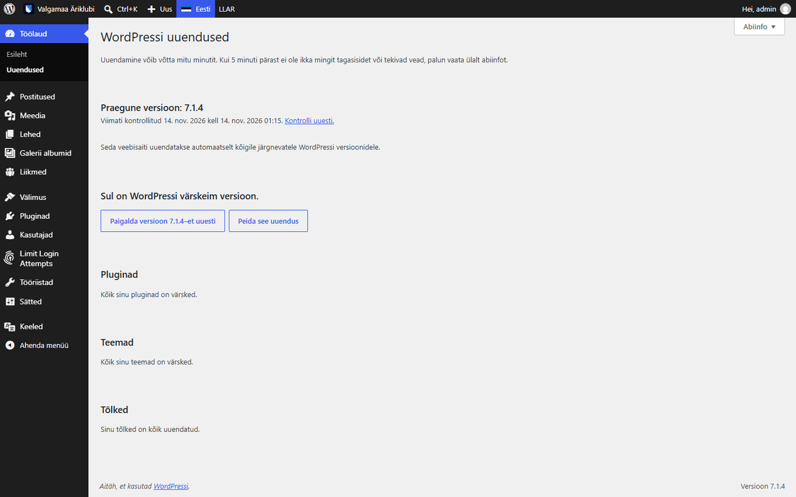

  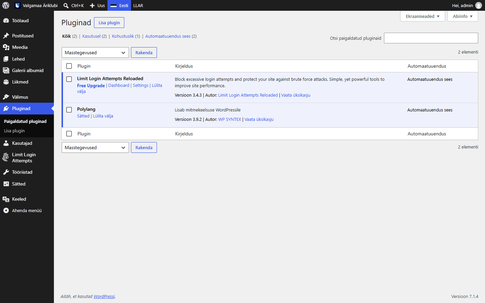

- **R1.4 PASS.** `DISALLOW_FILE_EDIT` = true (no theme/plugin editor in the menu). `xmlrpc.php` GET and POST return 403, and no `X-Pingback` header is sent. `/?author=1` (also `/en/?author=1`) answers 301 to the home page; `/author/admin/` is 404. `/wp-json/wp/v2/users` and `?rest_route=/wp/v2/users` return 404 for visitors. `wp-comments-post.php` returns 403; no page has a comment form; open comment status count 0; comments 0; the comments feed is empty. No `<meta name="generator">`.
  Minor: the core emoji script URL contains `?ver=7.1.4`, so the WordPress version can still be guessed. Not a requirement; accepted.
- **R1.5 N/A locally.** Tööriistad → Saidi tervis shows 2 critical items: "REST API andis vea" and the loopback request failure. Both happen because PHP's built-in server handles one request at a time, so WordPress cannot call itself; they do not occur on Apache/Zone. Recommendations: install a default theme (the native runner uses `--skip-content`; Docker and Zone have the default themes), an optional PHP module missing in the portable PHP, and "search engines discouraged" (intended locally). Recheck after go-live (DEPLOYMENT-ZONE checklist).

  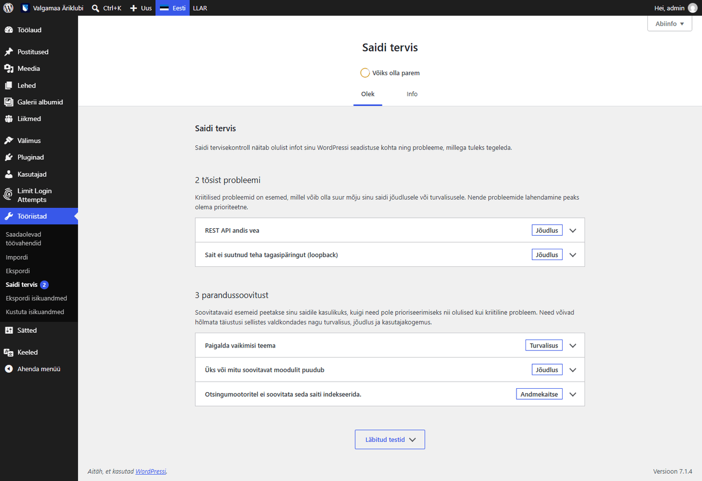

### R2: Local first, then Zone

- **R2.1 N/A locally: not executed (no Docker on the QA machine).** Static review of `docker-compose.yml`, `scripts/local-up.ps1`, `scripts/reset-local.ps1`:
  - Services `db` (mariadb:11, healthcheck), `wordpress` (php8.3-apache, port `${WP_PORT:-8080}`, healthcheck on `wp-config.php`), `wpcli` (profile `tools`, user 33 = www-data, same volumes and `WORDPRESS_*` env so it reads the same `wp-config.php`), `mailpit` (`${MAILPIT_PORT:-8025}`). `WORDPRESS_CONFIG_EXTRA` defines `WP_ENVIRONMENT_TYPE=local`, `DISALLOW_FILE_EDIT`, `WP_AUTO_UPDATE_CORE`, `FS_METHOD` and the Mailpit SMTP constants used by `mail.php`. Theme, mu-plugins, `content/`, `brand/`, `scripts/` and `php.ini` (64M/64M/256M) are bind-mounted.
  - `local-up.ps1` creates `.env` from `.env.example`, runs `docker compose up -d`, waits for `db` and `wordpress` to be healthy, runs `docker compose run --rm wpcli bash /scripts/setup.sh` (profiled services can be run directly) and prints URL and credentials. `reset-local.ps1` asks for confirmation (or `-Force`), runs `docker compose --profile tools down -v --remove-orphans` and calls `local-up.ps1`.
  - `.gitattributes` forces LF for `.sh`, `.php`, `.yml`, `.ini`.
  - No mistakes found in the scripts. Fixed in `docs/LOCAL.md`: the guide said a generated admin password is printed, but `.env.example` sets `ADMIN_PASSWORD=admin-local-only`; the port note now names `WP_PORT`/`MAILPIT_PORT`.
- **R2.2 PASS.** `.runtime/setup-rerun.log` (second run of `setup.sh` on the provisioned site): "Import finished (unchanged: 143)", and the summary counts equal the first run (`setup-reset.log`, "created: 143"): pages 12, posts 8, members 46, albums 76, patterns 1, menu items 12. Widgets are matched by stored hashes; footer areas still contain 2 widgets each.
- **R2.3 PASS (static review, not executed).** Every Zone panel step in `DEPLOYMENT-ZONE.md` is marked "(verify in panel)" or "(verify with Zone support)". The environment-variable table matches `setup.sh`; the missing optional variables (`DB_PREFIX`, `DISABLE_WP_CRON`, `SITE_TITLE`, `AK_FORCE_UPDATE`, `AK_RECREATE_DELETED`) were added. Admin labels in the checklist were corrected to the real Estonian ones (Sätted, Moodulid, Lisa kasutaja, the exact "Keela selle saidi indekseerimine otsimootorite poolt" text). The note about re-running `setup.sh` on the live site now says what it really re-applies.
- **R2.4 PARTIAL.** Locally `blog_public = 0` and every page has `robots: noindex`; sitemaps are off (404). `setup.sh` sets `blog_public = 1` when the environment type is `production` (the default on Zone, also set by `DEPLOYMENT-ZONE.md` step 5.2) and 0 otherwise. Verify on Zone with the go-live checklist.

### R3: Logo

- **PASS.** `brand/` contains `logo-horizontal-on-light.png`, `logo-horizontal-on-dark.png`, `logo-stacked-on-light.png`, `site-icon-512.png`, `og-image-1200x630.png` (+ SVG source). The coat of arms is the official blue/white shield with 4 stars; "Valgamaa Äriklubi" is spelled with a correct "Ä"; transparent background; text in the palette navy/cream and readable at header size. In WordPress: `custom_logo` = attachment 159 (header), `site_icon` = 160 (favicon and app icons in `<head>`), `ak_og_image_id` = 161 (`og:image` on every page). The coat of arms' blue is part of the unaltered arms, not a theme colour.

### R4: Colour palette and template

- **R4.1 PASS.** Grep of `wp-content/themes/ariklubi` for `#hex`, `rgb(a)`, `hsl` and named colours: the only hex values are `#010736`, `#0D1C42`, `#22396F`, `#FCF1D0` (in `style.css`, `editor.css`, `inc/palette.php`); `rgba()` values are tints of these four. No named colours. The mu-plugin has no colours.
- **R4.2 PASS.** Editor settings: the palette has exactly the 4 colours; custom colours, the default palette, custom gradients and default gradients are disabled.
- **R4.3 PASS.** Lighthouse accessibility 100 on Home, Gallery and Members, including the `color-contrast` audit. Main pairs: navy `#010736` on cream `#FCF1D0` and cream on navy (about 17:1).
- **R4.4 PASS.** 18 URLs (all main pages in ET and EN, single news, category archives, album, 404) at 320, 768, 1366 and 1920 px: `scrollWidth` never exceeds the viewport. The history table scrolls inside its own container (`overflow-x: auto`, sticky header row).

  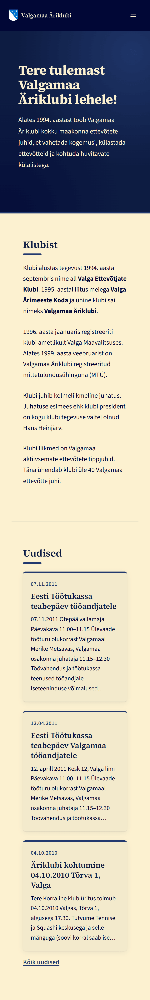

  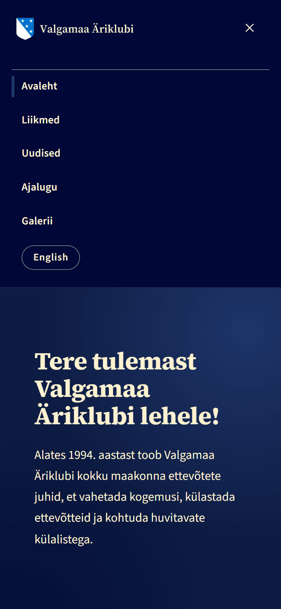

### R5: Home page

- **R5.1 PASS.** ET `/` and EN `/en/` contain the founding (1994), the merger (1995), the registration (1996), the MTÜ (1999), the president (Heinjärv) and the member profile.
- **R5.2 PASS.** `[ak_latest_news count="3"]` shows the 3 newest posts of the current language; `[ak_albums count="3" pagination="no"]` the 3 newest published albums (with QA albums published they appeared; with none published the empty-state text is shown).

  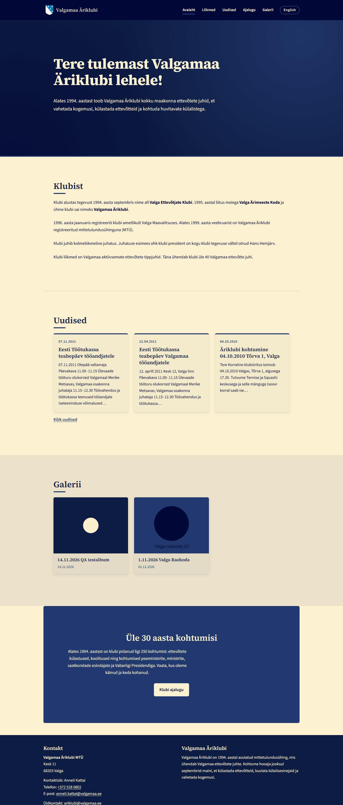

  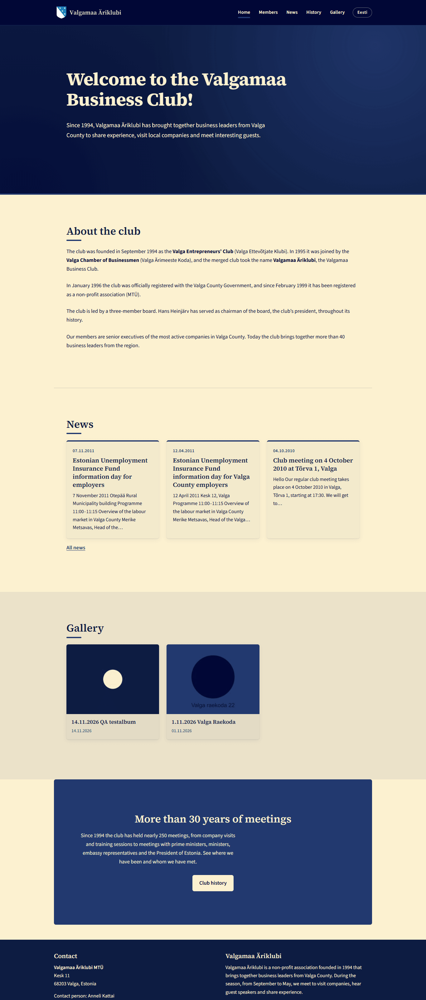

### R6: Members

- **R6.1 PASS.** 46 members on `/liikmed/` and `/en/members/`; 7 have websites, including `https://www.taimetee.ee/` (the fixed broken URL). The astelpajutooted address is plain `http://` as in the source.
- **R6.2 PASS.** Sorted by surname (Estonian alphabet). The ET and EN lists are identical apart from the visually hidden column labels.

  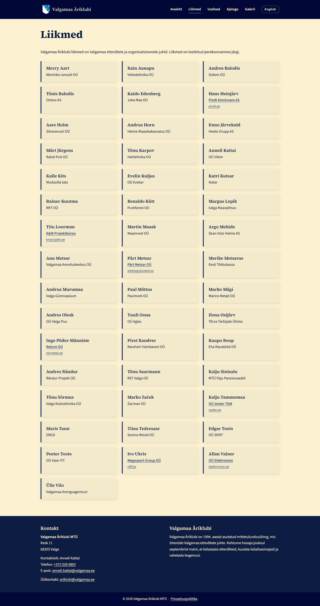

- **R6.3 PASS.** As the Editor `qa-editor` in the browser: Liikmed → Lisa uus liige, filled Ettevõte/Koduleht, Avalda; then Muuda → Uuenda ("Postitus uuendatud."), the change appeared on `/liikmed/`; then "Prügikasti" removed it from the list. No page content was touched. Guide addition: the admin list is paginated (20 per screen), so the guide now mentions the "Otsi liikmeid" search.

### R7: News

- **R7.1 PASS.** `/uudised/` and `/en/news/`; category archives `/category/uudised/` (1 post), `/category/kuulutused/` (3), and the EN equivalents News (1) and Announcements (3). The language switcher on a category archive leads to the translated archive.

  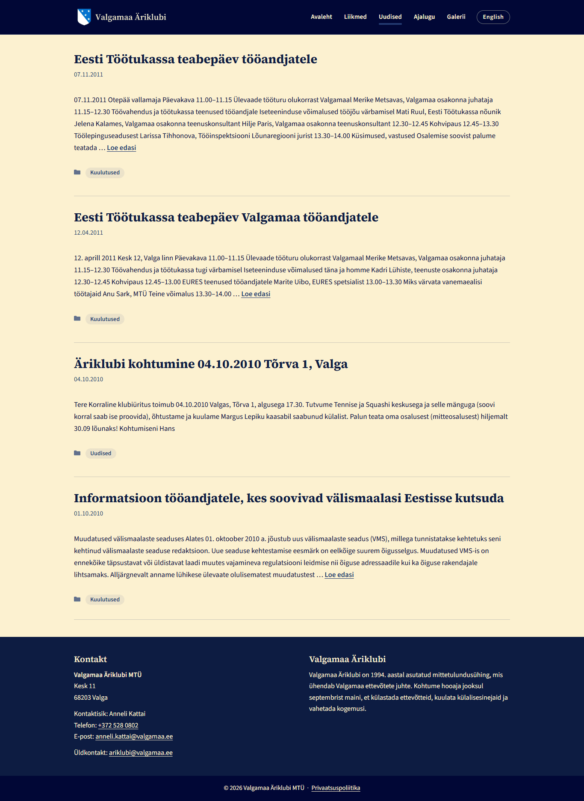

- **R7.2 PASS.** 4 posts per language with the original dates 07.11.2011, 12.04.2011, 04.10.2010 17:30 and 01.10.2010, linked as translations.
- **R7.3 PASS.** As `qa-editor`: Postitused → Lisa postitus, title and text, Rubriigid "Uudised", Avalda + confirm; then the "+" under Keeled → Tõlked opened the EN editor (language English, category already set to the translated "News"), English title, Avalda. Polylang linked both (`et` 237, `en` 239). Both test posts were deleted afterwards.

### R8: History

- **R8.1 PASS.** `/ajalugu/` and `/en/history/` start with the narrative (1994 Kungla bar meeting, original name, 1995 merger, 1996 registration …) in the respective language.
- **R8.2 PASS.** The synced pattern "Ajaloo tabel" is used on both pages: 270 rows in each, identical; newest first (2025 mai) to the oldest (1994 september); bilingual headers. Editing in one place: Mustrid (by URL) or "Muuda originaali" on the page (documented in the guide, screenshots included).

  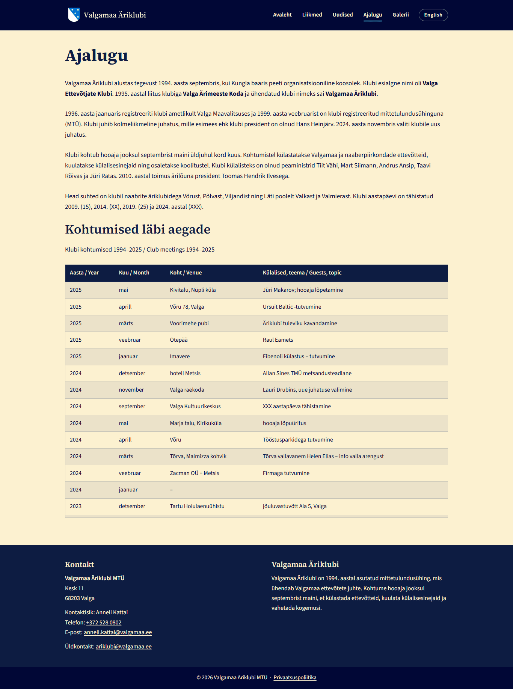

### R9: Gallery

- **R9.1 PASS.** `/galerii/` and `/en/gallery/` use `[ak_albums count="12" pagination="yes"]`: cards with cover, title and date, ordered by date descending (the guide album dated 01.11.2026 was listed after the QA album dated 14.11.2026). Pagination: with only 2 published albums the 12-per-page case could not be shown without publishing legacy drafts, so the shortcode was run with `count="1"`: one card and the pagination nav were rendered.

  

  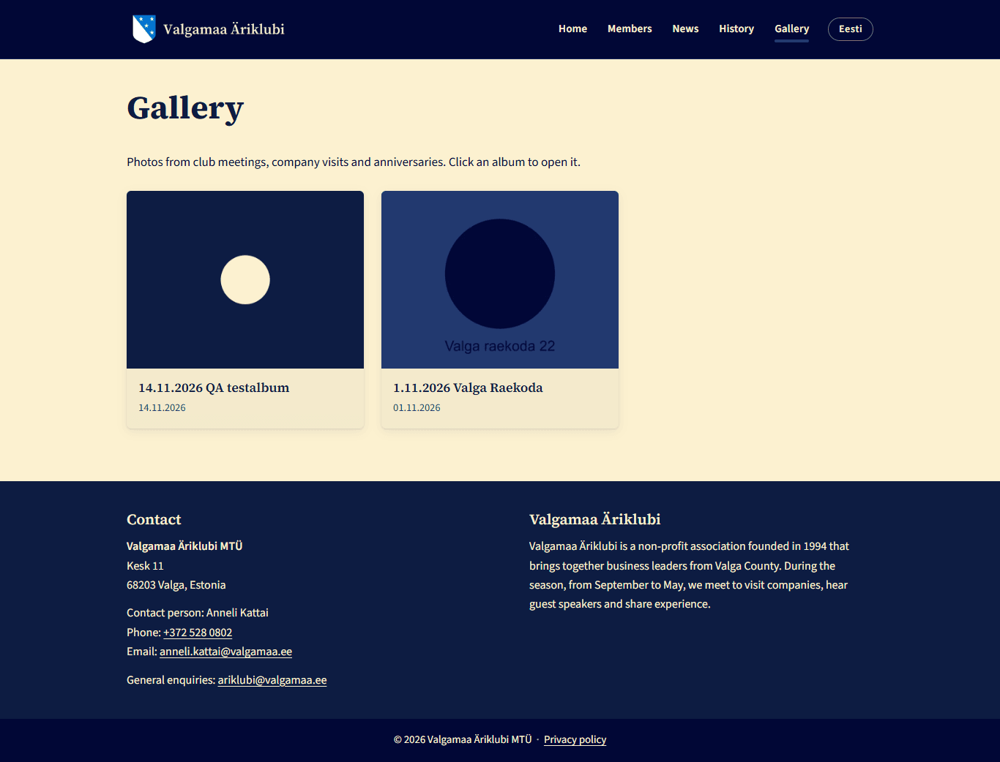

- **R9.2 PASS (touch not physically tested).** Album page: grid of the gallery block; every gallery image has a lightbox trigger (20 in the scripted QA album, 22 in the guide album). Click and Enter on a trigger open `.wp-lightbox-overlay.active` (`role="dialog"`, `aria-modal`, label "Suurendatud pilt 2/20: …" in the QA album). Arrow Right/Left and the "Järgmine"/"Eelmine" buttons change the image; Esc and "Sulge" close it, and focus returns to the clicked image. The same on a 390 px mobile viewport. Core's touch handlers (`touchstart`/`touchmove`/`touchend`, swipe navigation) are attached; swiping was not tried on a real device. Found and fixed: the close and arrow icons were invisible (fix 3 below).

  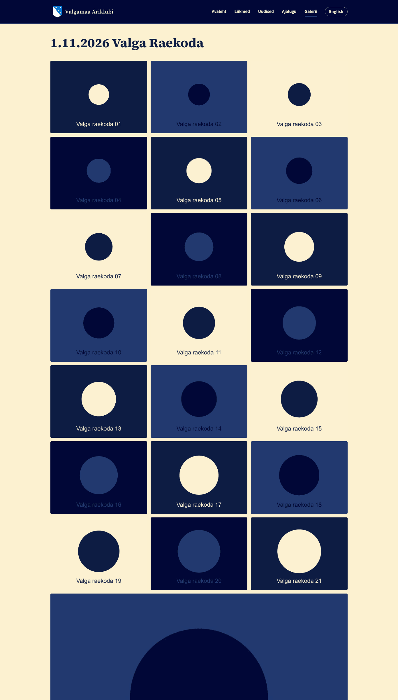

  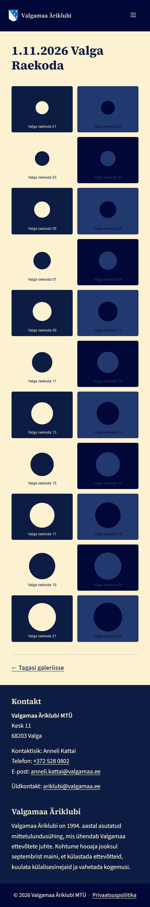

  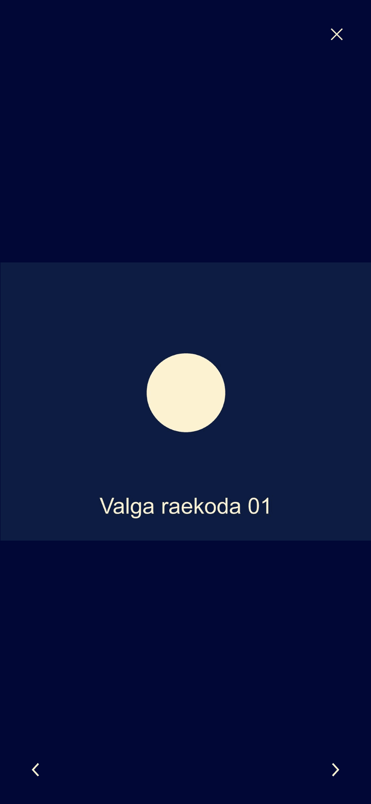

- **R9.3 PASS (after guide corrections).** A new Editor account `qa-editor` followed `ADMIN-GUIDE.et.md` chapter 3 literally in Chrome: Galerii albumid → Lisa uus album, title, date via the "Otsekohe" calendar, Laadi üles with **22 photos selected at once** (uploaded in about 15 s), columns, link check, cover via "Määra kaanepilt", Avalda. The album appeared on `/galerii/` with its cover and all 22 photos opened in the lightbox. Where the guide's labels or steps did not match the real Estonian WordPress 7.1 admin, the guide was corrected (both languages), for example: the menu item is "Lisa uus album"; a new album already contains a Gallery block; the date control is "Otsekohe" + calendar (a future date turns the button into "Järjekord"); the Gallery block settings are reached with "Vali ülemplokk: Galerii"; the link menu is "Viide" with default "Puudub" (which also opens the lightbox); the cover is set in the "Album" tab with "Määra kaanepilt" and the modal's "Meediateek" tab; old drafts have no Gallery block; translation "+" sits under "Tõlked"; Patterns are not in the menu; widgets are "Välimus → Moodulid"; "Uuenda" is "Salvesta" in the block editor; revisions are "Versioonid" → "Taasta see versioon". The album, its 22 media and the Editor were deleted afterwards.
- **R9.4 PASS.** 76 albums in status draft (64 with an event date, 12 with a floating date); 0 published after cleanup. Media library: only the 3 brand images (IDs 159–161); no legacy images.

### R10: Contact in the footer

- **R10.1 PASS (after fix 1).** On 21 URLs (both languages, archives, single post, album, 404) the footer (`.site-footer`) contains the club name, Kesk 11 Valga, Anneli Kattai, exactly one `tel:+3725280802` link and two `mailto:` links (anneli.kattai@valgamaa.ee, ariklubi@valgamaa.ee). Before fix 1, saving the widget screen once made both language versions appear together.
- **R10.2 PASS.** "Kontakt" on Estonian pages, "Contact" on English pages; privacy link per language.

  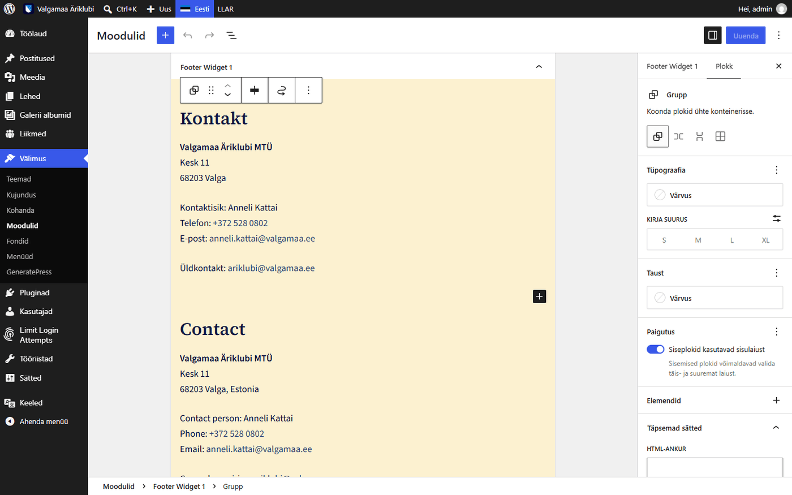

### R11: Localisation

- **R11.1 PASS.** ET at `/` (Polylang `hide_default`), EN at `/en/`; `redirect_lang` on. The switcher is in the header on every tested page and links to the translation (pages, posts, category archives); on album pages and the 404 page it links to the EN home page.
- **R11.2 PASS.** `<html lang="et">` / `<html lang="en-US">`; per-language menus and footer widgets; GeneratePress front-end strings in Estonian on ET pages (integration fix), English on EN pages. Dates use the site format `d.m.Y` in both languages (numeric, so language-neutral).
- **R11.3 PASS.** `hreflang="et"` and `hreflang="en"` alternates on all translated pages and archives. Album pages have none: albums are language-neutral (one URL for both languages), recorded in DECISIONS.

### R12: Legacy content captured

- **PASS** (planning). `legacy-pages/` present.

### R13: Handover documentation

- **R13.1 PARTIAL.** All five documents exist. 49 screenshots were captured from the local site and the Estonian admin and linked; all image links resolve. Screenshots that cannot be made without Docker or Zone are replaced by an italic "Screenshot to be added" note: `local-up.ps1` output and the Mailpit inbox (LOCAL.md), and the six Zone panel screens (DEPLOYMENT-ZONE.md). `local-native-output.png` is rendered from the real `setup-rerun.log`.
- **R13.2 PASS.** The guide covers login and password (1), gallery (3–5), news + translation (6), members (7), history table (8), footer contacts (9), pages (10), the "do not" list (11) and help (12).

### Non-functional

- **NF1 PASS.** Lighthouse 12.8.2, mobile form factor with default throttling, against the local PHP server:

  | Page | Performance | Accessibility | Best Practices | SEO | SEO excl. is-crawlable | FCP | LCP | TBT | CLS |
  |---|---|---|---|---|---|---|---|---|---|
  | Home `/` | 94 | 100 | 100 | 69 | 100 | 2.3 s | 2.6 s | 0 ms | 0.002 |
  | Gallery `/galerii/` | 95 | 100 | 100 | 69 | 100 | 2.1 s | 2.6 s | 0 ms | 0 |
  | Members `/liikmed/` | 92 | 100 | 100 | 69 | 100 | 2.4 s | 2.9 s | 0 ms | 0 |

  SEO is 69 only because of the "Page is blocked from indexing" audit (`blog_public = 0`, intended locally); every other SEO audit passes. Performance is understated locally: PHP's built-in server sends no compression and no cache headers, which Apache on Zone does. Remaining hints, all minor: render-blocking theme CSS, the 1200×300 logo PNG scaled down in the header, GeneratePress' small icon CSS, and the first gallery card image being lazy-loaded (it is the LCP image when albums exist).
- **NF2 PASS.** Every request of 18 front-end URLs went to `localhost:8080`; no Google Fonts, CDN, emoji CDN or trackers (fonts are self-hosted woff2).
- **NF3 PASS.** Privacy pages in ET and EN, linked from the footer of the respective language.

## Fixes made during QA

1. **Footer widgets lost their language when saved** (`wp-content/mu-plugins/ariklubi-core/polylang.php`). The block-based widget editor has no Polylang language field, so saving Välimus → Moodulid removed `pll_lang` from all four footer widgets, and the ET and EN contacts showed together on every page. New filter `ak_pll_keep_widget_language` on `widget_update_callback` keeps the existing language unless a new one is submitted. Verified with a real save in the admin; the widgets were then restored from the backup taken before the test.
2. **Child theme could be "updated" from wordpress.org** (`wp-content/themes/ariklubi/style.css`): added `Update URI: false`, because theme auto-updates are on and a public theme with the slug `ariklubi` would otherwise be offered as an update.
3. **Invisible lightbox buttons** (`wp-content/themes/ariklubi/style.css`): WordPress 7.x renamed the buttons (`.wp-lightbox-close-button`, `.wp-lightbox-navigation-button`) and prints an inline black fill, so the close/prev/next icons were black on navy. The theme now colours them cream (palette) with hover/focus tints and a visible focus outline.
4. **Admin guides** (`docs/ADMIN-GUIDE.et.md`, `docs/ADMIN-GUIDE.en.md`): labels and steps corrected to the real Estonian WordPress 7.1 admin (see R9.3), Editor vs Administrator menu differences, member search, all screenshots linked.
5. **LOCAL.md**: default admin password, port variables, Docker screenshots replaced by notes.
6. **DEPLOYMENT-ZONE.md**: missing optional `setup.sh` variables, Estonian labels, the re-run note, Zone screenshots replaced by notes.
7. **DECISIONS.md**: deviations recorded (widget language filter, `Update URI`, lightbox CSS, language-neutral albums, Patterns not in the menu, default gallery link).

PHP files were linted with `.runtime\php\php.exe -l`; edited files are UTF-8 without BOM, LF.

## Integration fixes (made by the integrator before QA)

- `scripts/setup.sh` always enforces `SITE_URL` for `home` and `siteurl` (WP-CLI on Windows could guess a wrong URL during install).
- `setup.sh` writes `ak_setup_initialized` idempotently (only when not yet set).
- Polylang `redirect_lang` set to true.
- The importer no longer writes the GeneratePress `generate_settings` option.
- The importer uses Polylang's `languages->get()` when saving the PLL_MO string translations.
- mu-plugin: `og:image` reads the `ak_og_image_id` option.
- mu-plugin: spacing fixed in the generated plain-text excerpts.
- Theme: removed `overflow-x: clip` on `#page`.
- Theme: the featured image is hidden on single album pages (the cover is shown on the cards only).
- Theme: the "Galerii"/"Gallery" menu item is highlighted on single album pages.
- Theme: Estonian strings for GeneratePress front-end texts.

## Observations (no action required)

- Widget screen shows a red notice about the GeneratePress block `generatepress-content-width` (a parent-theme editor plugin, harmless); the guide tells editors to ignore it.
- The "Right Sidebar" widget area still holds WordPress' default widgets (search, recent posts, recent comments). It is not displayed by the theme's layout; leave it.
- GeneratePress' "Layout" box in the editor is in English (the theme has no Estonian translation).
- The members edit screen shows a "Lisaväljad" (custom fields) box because the CPT supports custom fields; the guide says to ignore it.
- A gallery whose image count is not a multiple of the column count stretches the last image across the row (core Gallery block behaviour with "Kärbi pilte sobivaks" on).

## Clean-up done

- QA albums (the scripted test album and the guide album) and all their media deleted, including the files in `uploads/`; QA news posts (ET + EN), the QA member and the auto-drafts deleted; user `qa-editor` deleted.
- Final state: `wp post list --post_type=ak_album --post_status=publish` is empty; 76 album drafts; 3 attachments (IDs 159, 160, 161); 46 members; 8 posts; 12 pages; one user (`admin`).
- QA tooling (puppeteer, Lighthouse, scripts, test photos) lived only in `%TEMP%\ak-qa`; temporary helper scripts in `.runtime/` were removed. The local web server is still running.

## Open items for the owner / client

1. **Docker path:** run `scripts/local-up.ps1` once on a machine with Docker Desktop, then add the two screenshots (script output, Mailpit inbox) to `LOCAL.md`.
2. **Zone deployment:** follow `DEPLOYMENT-ZONE.md`; confirm every "(verify in panel)" step, add the six panel screenshots, and confirm the Zone support phone/email.
3. **Production checks:** Site Health without critical issues, search engines allowed, server cron running, a 20-photo test album uploaded and deleted, Lighthouse rerun on HTTPS (expected to be better than locally).
4. **Touch:** swipe through an album lightbox on a phone once after go-live.
5. Open questions from `PLAN.md` §8 (domain, board names, old partner logos, permission for the coat of arms) remain with the club.
